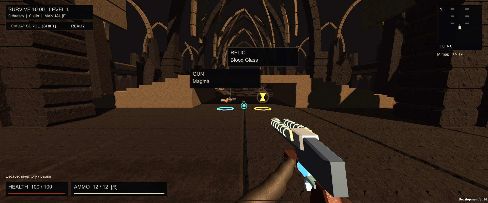

# Hexwake

**A first-person horde-survival shooter. Build a six-gun arsenal, find strange relics, and outlast the swarm.**

Windows x64 · Single-player prototype · Keyboard and mouse

**[Download Hexwake for Windows](https://github.com/OpenCnid/game-dev-journey/releases/download/hexwake-v0.1.0/Hexwake-v0.1.0-windows-x64.zip)**

[Release notes](https://github.com/OpenCnid/game-dev-journey/releases/tag/hexwake-v0.1.0) · [Source and build instructions](prototypes/002-hexwake/README.md)

## Play in a minute

1. Download the Windows ZIP above.
2. Extract the **whole folder**, not just the executable.
3. Run **`Hexwake.exe`**, choose a starting weapon, and click **Begin**.

No Unity installation is needed to play. Keep `Hexwake_Data`, `MonoBleedingEdge`, and the adjacent DLLs beside the executable.
While this repository remains private, downloads require repository access.

## What you're playing

Survive a ten-minute run through a dark fantasy arena with magic, technology, and increasingly persistent enemies.

- **Grow an arsenal:** collect dropped guns, including duplicate copies, up to six independently firing weapons.
- **Make a build:** levels and successful weapon use improve gear you already own; enemy loot brings new guns and relics.
- **Find strange advantages:** relics change headshots, healing, reloads, air control, and other combat interactions.
- **Keep moving:** aim, jump, bunny-hop, and use your class's mobility ability instead of standing still.
- **Read the action:** large gun models and gold relic seals distinguish valuable drops from routine XP. Pause to inspect the full inventory.

Automatic firing is available, with a manual-fire toggle when you want direct control.

## Controls

| Input | Action |
| --- | --- |
| WASD / mouse | Move / aim |
| Space | Jump / keep hopping |
| Shift | Class mobility |
| F | Toggle automatic / manual firing |
| Left mouse | Fire in manual mode |
| R | Reload |
| E | Collect a gun or relic |
| 1-6 | Select a gun; at full capacity, select the copy to replace |
| 1-3 or mouse | Choose an upgrade |
| Escape | Frozen inventory / pause / resume |
| M | Frozen map and settings |

Pause includes graphics presets and master volume. Upgrade choices also freeze the action.

## Current build

**v0.1.0** is the current Windows prototype, published from the playtested J/R6 revision with a new public name. It is a development build, not a finished commercial game.

The release was checked with the retained gameplay suite and rendered scenarios. There is no multiplayer in this build; cooperative play remains a longer-term design direction.

See the [verification and known limits](prototypes/002-hexwake/VERIFICATION.md) and [asset/runtime notices](prototypes/002-hexwake/THIRD_PARTY_NOTICES.md).

## Why this repository exists

I'm a software engineer learning to make a first game with AI. This is the working game and the record of the experiments, playtests, wrong turns, and lessons behind it.

Hexwake is the newest playable snapshot. The earlier [stacked-weapons Unity project](prototypes/001-stacked-weapons/README.md) and its experiments remain intact; its engine pin and benchmark results do not describe this release.

- [Project foundation](docs/foundation.md) - longer-term player experience and systems.
- [Current state](docs/current-state.md) - what has actually been built.
- [Playtest history](docs/playtests/) - results and lessons.
- [Contribution guide](CONTRIBUTING.md) - working with the project.
- [AI workflow](AGENTS.md) - instructions for coding agents.

Previous versions of this landing page remain in Git history.
