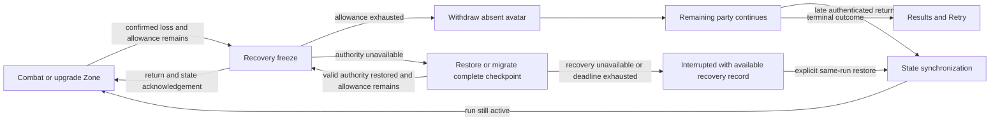

# Cooperative disconnect recovery

**Design draft, October 4, 2026.** Research and policy design for [GDJ-13](https://linear.app/cnid/issue/GDJ-13/research-death-revival-and-continued-player-participation), with [GDJ-7](https://linear.app/cnid/issue/GDJ-7/build-party-thinking-space-for-cooperative-upgrades) and GDJ-20 as consumers. Serves perceptible power growth and readable, responsive co-op: a connection failure should not discard a build or immobilize the remaining party indefinitely. No recovery code, play evidence or service/package selection accompanies this document.

## Accepted direction and proposal boundary

The owner requests a disconnect freeze presented through **The Zone**, initially describing five minutes to reconnect, and explicitly selects:

- **Five minutes total per run**, shared across automatic disconnect pauses, rather than a fresh five minutes for every drop.
- **Allow later return with preserved progress** if the player misses that window and the same run is still ongoing.
- Do not let disconnected participants block resuming indefinitely.

[Decision 0012](../decisions/0012-disconnect-recovery-and-preserved-return.md) records that owner direction. The timeout removal, reward/readiness details, resume presentation, re-entry safety and host-recovery architecture below are **recommended candidates**, not additional owner approvals or implemented capabilities.

Recommend withdrawing the disconnected avatar after grace, retaining a return record for the original participant. Leaving a motionless body to die would turn a network problem into combat damage, repeated death/return activity and a confusing party-wipe contribution. Withdrawal permits the remaining party to continue while preserving the absent player's build. It also reduces the team's combat output; difficulty changes and any advantages from protected absence need human/balance evidence.

## Five-minute recovery budget

At confirmed connection loss, the authority finishes or preserves its last committed simulation boundary and adds a **Recovery** pause reason. Freeze movement, firing, enemies, projectiles, abilities, pickup collection and every active encounter clock: duration, cooldowns, timed effects, death/return and immunity. No health refund or undo of damage already committed before loss detection. The network, reconnection attempts, UI and wall-clock deadline continue. Detection delay is separate from the recovery allowance; the current Transport inactivity timeout is five seconds and cannot detect a cable pull instantaneously.

Each run starts with **300 seconds of automatic recovery allowance**. Subtract real elapsed time while the Recovery reason is active, including recovery-caused synchronization, migration and frozen resume countdowns, once for the party rather than once per absent player. A 45-second interruption leaves 255 seconds for later interruptions. Reconnect handshakes, another player dropping or host replacement cannot refill that allowance. Repeated losses within an incident retain its deadline; a later distinct incident uses only the remaining allowance. When it reaches zero, further disconnects use withdrawal/rejoin without another automatic world freeze or extra countdown. Retry creates a new run and restores the allowance.

Keep recovery expenditure/incident/deadline metadata separate from rollbackable world checkpoints: restoring an older world cannot increase the remaining allowance. Use monotonic elapsed time locally, charging application stalls and suspend/resume; specify a trusted cross-process time basis before migration. An application-relative timestamp cannot be copied to a replacement host as an absolute deadline: [Unity's real-time clock](https://docs.unity3d.com/6000.3/Documentation/ScriptReference/Time-realtimeSinceStartupAsDouble.html) is measured since that application started. Recovery downtime must still be charged. If the latest budget/deadline cannot be established after failure, require explicit interrupted recovery rather than inventing a fresh automatic allowance. Persistence of this metadata is a migration prerequisite, not an implemented guarantee.

Recovery ends when all players being awaited have restored and acknowledged the current authoritative state and any bounded resume countdown finishes, or the remaining allowance expires. Cap the proposed countdown at the incident deadline; do not restart it beyond that deadline or add an unlimited recovery-ready vote. At expiry, withdraw unresolved participants. A real earned-choice Zone remains a separate pause reason. A proposed unanimous **Continue while they reconnect** action for connected participants must withdraw unresolved participants before physical resume, retain their return records and preserve unused allowance after any charged countdown. It is optional scope, not required for the first implementation.

An expired pause is not a combat death. Preserve the original run/player/weapon identities and record connectivity separately from HP and life. Show the absent player as **Away — can rejoin** in the session UI. Remove their avatar from enemy targeting, collisions, firing, pickups and active readiness. Retaining session membership/return authorization is necessary for the selected late-return behavior; removing them permanently from the service lobby would require a separately validated rejoin path.

## Reconnect before and after expiry

| Situation | Recommended behavior |
| --- | --- |
| Return while recovery allowance remains | Verify the original player, restore a fresh connection, send frozen authoritative run state and acknowledge it before input resumes. Reuse the exact HP/build/choices; no heal, reroll or new starter character. End Recovery when all awaited players are synchronized. |
| Return after withdrawal, run still active | Synchronize during ongoing play, then activate at an authority boundary. Preserve progress and life state. Do not automatically freeze the party again for this admission. |
| Returning participant was dead | Preserve death and remaining active-time return state; reconnect alone does not revive. Apply the subsequently selected death/revival rules. |
| Run already complete or defeated | Show the authoritative terminal result. Reconnect cannot undo it or award a second completion. A new run requires Retry. |
| Session interrupted or dormant, with no committed terminal outcome | Show explicit recovery options. Restore may continue the same run from recoverable state; Retry starts a new run. A local interrupted UI does not finalize the run. |
| Original participant lost connection again | Use only the remaining shared recovery allowance; replace the old connection generation. A duplicate rejoin does not create another avatar or benefit. |

For a late living return, propose a navigable entry point near a living teammate with a brief indicated contact-protection interval, preserving existing HP. The prototype's one-second return immunity is a test starting point, not an accepted reconnect balance value. During an early return while the world is still frozen, retain the original position. Final re-entry placement/protection needs tests against crowded enemies, bounds, deliberate repeated disconnects and boss phases. If safe activation or synchronization is unavailable, remain withdrawn with a clear status; avoid advancing a half-restored character.

Preserve weapons, applied effects/ranks, current HP/life, pending choices, revealed offer IDs, personal draw/random state and exactly-once reward records. Reset local prediction and transport queues, not the player's run progress. Verify identity with a run-bound reconnect credential and a fresh connection generation; reject old-generation inputs, shots and selections. A local slot number alone cannot prove that a returning connection belongs to its previous occupant.

Provide a persistent **Rejoin** entry from the main menu for the original participant, including after restarting the application. Original-player identity/return authorization must survive that restart; restore authorization before reclaiming the retained state. First-slice late admission is limited to the original roster, with at most four identities: introducing replacement players or brand-new mid-run joins needs separate rules.

**Proposed reward eligibility:** the original run participant retains shared team XP/earned-choice entitlements and applicable selected team grants while withdrawn. Offers remain personal and never auto-select or reroll merely because of reconnect. Preserve unspent entitlements and disclosed offers; reconnect consumes no extra draw. Record reward/selection IDs so replication or replay cannot grant twice. This supports returning with the team's progress rather than an obsolete build, but expands participant eligibility beyond the current fixture and requires review with GDJ-13/GDJ-14. Qualifying rarity tiers, incompatible recipients and modifier/draw ordering remain their existing design questions. No pickups, damage, kills or active combat contribution are generated by absence or wall-clock waiting.

## The Zone, readiness and endings

Represent **Recovery** and **Upgrade thinking** as separate reasons for freezing the same physical encounter. Recovery can enter without an earned choice; its automatic waiting allowance is bounded. [Ordinary thinking space](../decisions/0004-party-thinking-space.md) retains unlimited earned-choice time and readiness-based resume. The five-minute budget does not cap a connected player's legitimate upgrade reading or choose a card for them.

A disconnect during an existing Zone adds recovery handling without regenerating offers or replacing the phase. Expiring Recovery removes only that reason. Withdrawn participants cannot veto readiness; connected eligible participants still finish their choices under the ordinary Zone rules. Explicitly entering upgrade thinking during recovery may keep that independent pause active after the recovery wait ends; communicate both reasons. Rejoining restores the current phase and its eligibility, rather than resetting the party to a lobby or silently unpausing.

Recommend evaluating defeat against the **active combat participants** after withdrawal. If every remaining active participant is dead/waiting, defeat follows the accepted all-dead rule despite pending timers; a withdrawn living player cannot keep the encounter alive. Rejoin cannot reverse a defeat committed before admission. This active-participant eligibility is a proposal; [decision 0010](../decisions/0010-xp-pickups-and-death-participation.md)'s defeat ordering remains accepted. No remaining active participants means an interrupted/dormant recoverable session, not victory; close unused execution resources when a complete checkpoint is available. Restoring a dormant run is explicit recovery, not a new completion award. Its storage lifetime remains to specify.

**Proposed control-boundary ordering:** serialize expiry, withdrawal and admission through the authority even while physical simulation is paused. At or after the authoritative deadline, expiry wins over acknowledgements not already committed before it; a client's claimed send time cannot extend grace. Apply withdrawal, then evaluate terminal eligibility, then admit later returns if the run remains ongoing, then recompute pause/readiness. This prevents a living disconnected slot from keeping all-dead peers frozen inside an upgrade Zone. Here active membership means admitted participation, including dead/waiting players, rather than only living avatars. With no admitted participants use interrupted/dormant recovery; with admitted participants all dead/waiting, apply defeat. A stale ready/ack must reference the current phase/membership or recovery incident before it can affect resume. Proposed absent death/return-timer behavior also needs explicit per-participant elapsed/remaining time, rather than reusing an obsolete global timestamp after withdrawal.

The diagram simplifies independent pause reasons: a legitimate upgrade Zone can remain active after Recovery ends.

## Host loss: continuity needs authority state

| Failure | Recovery candidate |
| --- | --- |
| Client connection drops | With allowance remaining, the live host freezes, retains the authoritative run and accepts the original member's reconnect. At zero allowance, withdraw the absent member and use late return while valid authority continues. |
| Host network drops but its game process survives | Clients stop prediction/actions on stale authority. With allowance remaining, the host enters recovery on peer loss and retains its run. Restore communication and synchronize within the same allowance. At zero allowance, the live host may withdraw absent clients and continue its valid run; unreachable clients show interrupted/rejoin status rather than inventing an outcome. |
| Host crashes, closes or loses power | Another eligible participant must obtain valid authority from a complete committed checkpoint, or the party must rehost a durable checkpoint. Retrying sockets or relabeling a lobby host cannot recreate authority-only state. |
| No complete recoverable state or safe replacement authority exists | Report an interrupted run, preserve available recovery evidence/save, and offer an explicit rehost/Retry path. Do not claim seamless continuation. |

Recommend **checkpoint-backed host migration as the long-term peer-hosted target**, with same-host reconnection as the first bounded implementation. During host recovery, keep The Zone/recovery presentation. A replacement host restores state before publishing outcomes; the original host returns as its ordinary player. Host recovery spends the same run-wide allowance and retains its deadlines. Choosing the host and transferring complete state are different operations, as [Unity's migration documentation](https://docs.unity.com/en-us/mps-sdk/session-host-migration) explicitly explains.

If the remaining allowance expires before valid host authority is restored, **end automatic waiting and show an interrupted session with explicit Restore/rehost/Retry options**, even if a complete checkpoint exists but transfer/election is still unfinished. Clients cannot resume authoritative combat without a valid host. Explicit recovery may finish restoring that checkpoint or reconnect to a live authority, but cannot refill the allowance or silently extend the automatic freeze. A client's interrupted connection UI is not proof of an authoritative defeat/completion; restored authority supplies the actual run outcome.

Migration requires safe authority election/fencing: only one authority term may issue valid state. An isolated old host must stop when it loses authority and accept the newer term when returning. Selecting the lowest player ID independently on each machine cannot resolve a partition safely; service-backed election/leases or a proven coordination mechanism need a dedicated feasibility decision. With two peers, either being unreachable does not itself prove it crashed. No lobby/relay/backend has been selected.

Before enabling automatic migration, define how every host proves its authority grant remains valid before advancing simulation or committing results, and how an isolated old host stops without hearing the replacement. A higher term in received packets alone does not stop an unreachable host. If a safe grant cannot be obtained, use interrupted recovery; a two-peer timeout is not permission for both sides to self-promote. The first same-host slice has no automatic replacement authority, so retaining that original authority does not claim partition-safe migration.

A complete recovery record includes session/run/configuration/version, committed tick and active clocks, authority term, roster/connection generations, recovery budget/pause reasons, all player builds/lives/cooldowns, personal offers/random streams, XP/entitlements and grant/selection ledger, enemies/incarnations/ability state, projectiles, pickups/consumed IDs, and simulation random/ordering state. A display snapshot or seed alone is insufficient. The current SharedSnapshot omits host-only random state, cooldown/deduplication arrays and pending work. Transport restore and stale-input invalidation need a fresh baseline; either preserve necessary history coherently or reject commands from before recovery.

Keep acknowledged upgrade/award decisions recoverable so restoring does not reroll confirmed choices or duplicate rewards. Periodic world checkpoints may involve visible rollback; checkpoint frequency, committed-event coverage, storage durability, allowable rollback and recovery time are **open engineering budgets**, not a zero-loss guarantee. A freeze gives recovery time, but cannot manufacture missing state. For the >10,000-enemy ambition, measure checkpoint size/serialization/transfer cost against ordinary frame budgets before choosing frequency. Chunk bounded recovery transfers; do not enlarge the present 1,100-byte single packet or continuously stream full dense worlds without measurement. A persistent dedicated authority is an alternative if its operating cost later fits; it does not require changing lobby/player/build ownership.

## Networking and scale contract — second review

Reviewed source **7ccb34aaaa137f649917abd5fb54350a9cd760fc** on October 4 through independent protocol, scalability and state-rule investigations, with parent verification against Unity **6000.3.25f1** / Transport **2.7.4** and the current runtime. The findings below tighten proposed contracts; they do not add owner approvals, runtime security claims or measured scalability. The current fixture still aborts on loss.

### Identity and message acceptance

Issue an unpredictable reconnect credential scoped to the original participant/run, protect it in storage and use authenticated encrypted transport before remote recovery. Verify the authority's identity as well as the returning player's authorization; do not send secrets in logs, lobby metadata or other participants' world baselines. Keep host-side verification/claim state separate from replicated gameplay state. Atomically bind one authorized connection generation to the participant: concurrent or rejected claims cannot displace the active occupant, create another avatar or spend pause allowance. Only loss of an admitted authenticated participant can create a Recovery incident; failed admission attempts cannot. Credential renewal/revocation and application-restart recovery must retain a valid original-player proof. [Bearer-token disclosure principles](https://www.rfc-editor.org/rfc/rfc6750) support protecting possession-based credentials; this does not select OAuth or a transport/security package. This is trusted peer-hosted co-op, not protection against a malicious authority fabricating gameplay outcomes.

Authorize message types by sender and state. Bind gameplay and control/state traffic to session/run, authority term, restoration epoch, connection generation and sequence/operation identity; readiness and synchronization additionally name their phase/incident/baseline. This includes Abort/leave, Retry, Ready, snapshots, grants and acknowledgements, not only shots. An authenticated restoration baseline in a newer epoch may replace a higher old display tick after legitimate checkpoint rollback; tick comparison alone cannot establish freshness. Validate schema/version, lengths/counts, finite/ranged values and bounded decoding/assembly work before mutation or allocation. Invalid/pre-admission traffic is rejected or closes that connection; it cannot directly abort the whole party. Transport delivery is not authorization or application-level once-only processing.

### Late admission and traffic budgets

Capture an immutable baseline at one committed tick/index, identified by the session/run/authority/restoration/generation and configuration/schema versions. Transfer it with a bounded manifest, verified completeness and size/hash, then apply the ordered authoritative changes after its cut. A hash detects incomplete/corrupt assembly; sender authenticity still comes from the secure connection. A generation-bound acknowledgement of a defined catch-up boundary precedes atomic activation. Cancel staging on Retry, authority/epoch changes or terminal outcome; never merge chunks from different baselines. If bounded catch-up history overflows or the player cannot catch up, discard that staging and remain withdrawn with a clear retry status, without another automatic party freeze.

Reserve live control/combat traffic ahead of bulk recovery; chunking alone does not prevent ordered-stream blocking, receive-loop frame spikes or shared-link saturation. Bound bytes, outstanding chunks, assembly memory, decoding work and retry/backoff per peer, and pace aggregate traffic. Treat transient send-queue pressure as bounded backpressure rather than a global abort. Start with one bulk admission at a time for the fixed-pair slice; establish fairness/resource limits before three simultaneous returning peers. [UDP usage guidance](https://datatracker.ietf.org/doc/html/rfc8085#section-3.1) requires considering aggregate congestion, including traffic from separate sockets; a second channel does not create bandwidth.

For baseline size **S**, usable transfer throughput **B**, and catch-up production rate **r**, baseline transfer takes approximately **S/B** and catch-up requires capacity above **r**. This is a cost model, not a timing result. Retain the first recovery slice's **two players, 12 drones and fixed rifle**. The current encoder uses 20 payload bytes per enemy and publishes at 60 Hz: generalizing that full-state scheme to 10,000 enemies implies approximately **12 MB/s per client**, **36 MB/s for three clients**, before overhead, players, projectiles or abilities. Before dense/four-player expansion, choose and measure a replication cadence, delta/interest or another bounded strategy, alongside network CPU/bandwidth/latency and visible frame budgets. Smooth local rendering does not establish network feasibility.

### Checkpoints, commitments and retention

Capture coherent state at a committed boundary using immutable ownership or a validated versioned capture; spreading serialization of mutable state across frames can mix ticks. Bound staging buffers, work per frame and retained snapshots, and publish only complete verified checkpoints atomically while retaining the last valid one. Do not multiply dense-world storage by the current full pose-history strategy without measurement. Persist dormant state before releasing its last valid execution owner; if storage fails, report that recovery is unavailable rather than deleting the only return record silently. Define explicit dormant retention/cleanup and version compatibility before offering durable restore. Active-run return records must remain available for that run's lifetime.

Before acknowledging a selected upgrade, team grant, committed terminal outcome or Retry transition as recoverable, atomically commit its effect and operation-result/deduplication record to the chosen failure-surviving store or replica. The stated guarantee must name which failures that location survives; host RAM alone cannot support a host-crash guarantee. Lost confirmations replay the recorded result using a stable original-player/run operation ID, including across connection changes, without applying the effect again. If storage is unavailable, keep the operation pending or reject it explicitly rather than confirming a durable success. The [Raft paper, sections 7–8](https://raft.github.io/raft.pdf) documents snapshot/log boundaries and retained request/results for crash retries; it is a reference pattern, not an instruction to adopt consensus for every combat tick.

Checkpoint materialized XP/build/entitlement state with per-stream watermarks and necessary gaps/results, then compact only events covered by recoverable state and the bounded retry policy. Preserve unspent choices, disclosed offers and unfulfilled absent-player grants. Four player identities do not bound an append-only kill/pickup/grant ledger. Keep commitment/budget metadata that cannot roll back outside ordinary world rollback, and reject terminal/run resurrection from an older checkpoint. Storage and compaction budgets remain to select and test.

Source checks: [SharedConnection](../../prototypes/001-stacked-weapons/Assets/Prototype/Runtime/SharedConnection.cs) lines 30–38/68/108–113/141 have protocol-only setup, one ordered pipeline, unbounded receive draining, fatal send failure and the 20-byte enemy encoding; [SharedGame](../../prototypes/001-stacked-weapons/Assets/Prototype/Runtime/SharedGame.cs) lines 84–91/129/182 have run/tick snapshot ordering, unscoped Abort, network polling before stepping and per-tick publishing; [SharedEncounter](../../prototypes/001-stacked-weapons/Assets/Prototype/Runtime/SharedEncounter.cs) lines 74–89/175/193 retain 31 full pose snapshots and evaluate defeat/targeting inside physical stepping. These are fixed-fixture constraints and illustrate why adding reconnect to its current transport loop is insufficient.

## Research: verified patterns and limits

Checked October 4, 2026 through two independent game investigations and a separate authority review. Material official Steam statements were checked against the Steam news API when the rendered pages exposed only images. These are documented capabilities, not our own game playtests or evidence that every connection failure is handled well.

| Game and evidence date | Verified pattern | Limits relevant to this design |
| --- | --- | --- |
| **Gunfire Reborn**, Steam/PC September 12, 2024 | The official base-game update adds return to ongoing **Main Stage** multiplayer after crashes or network disconnections. [Update](https://steamcommunity.com/games/1217060/announcements/detail/4578560647863757361). | Does not specify timeout, exact restored HP/build, automatic freeze or host migration. Do not extend to other platforms or modes. |
| **Ember Knights**, Steam/PC v0.12 June 6, 2023; July 29, 2024 update | Explicit disconnected-player rejoin support; later update adds **Rejoin** in the main multiplayer menu and reconnect-aware Steam invitations. [Reconnect release](https://store.steampowered.com/news/app/1135230/view/3709322161730527688), [menu/invitation update](https://steamcommunity.com/games/1135230/announcements/detail/4156338670617436887). | Exact state retention, automatic pause, time window and host migration are unspecified in those notes. Save & Quit is not proof of online host-crash recovery. |
| **Risk of Rain 2**, v1.3.1 August 27, 2024; v1.3.7 March 4, 2025 | Official multiplayer pausing support, plus a later fix involving a client leaving/rejoining a multiplayer run. [Pause notes](https://steamcommunity.com/games/632360/announcements/detail/4281321170606899294), [rejoin-related fix](https://steamcommunity.com/games/632360/announcements/detail/524210308312467805). | Pause and rejoin are distinct. The fix does not define every supported platform, recovery circumstances, restored state or host recovery. Older claims that all pausing requires mods are stale. |
| **Ravenswatch**, current support and February 17, 2026 v1.4.02 | Official support says host abandonment prevents continuing because the host holds party state. Official notes adjust when a reconnection pop-up appears. [Support](https://www.passtechgames.com/ravenswatch-support/), [pop-up patch](https://www.passtechgames.com/ravenswatch-news/ravenswatch-patch-note-version-1-4-02-all-platforms/). | Notification timing is not a reconnect allowance. These sources do not verify application-relaunch recovery or a five-minute automatic pause. Host loss is an important negative precedent. |

No reviewed official source verifies the complete proposed **five-minute shared pause allowance + safe withdrawal + late preserved return + host-crash continuity** contract. The allowance and withdrawal choice are our policy design, not borrowed proven balance. Supplemental mod/community reports were not used to establish official behavior. Rejoin UI, application-restart recovery and explicit host-loss handling are useful documented patterns; fun and reliability still require human play and failure injection.

## Bounded implementation and verification handoff

Current base **d63b532de33470d7498d2e450b5843840914f5ea** already has fixed two-player shared rifle authority, but loss directly aborts. `SharedConnection` owns one peer and protocol-only Hello; `SharedGame` forwards loss to Abort and uses a real-time authority accumulator. Existing GDJ-20's accepted fixed fixture and performance/human acceptance remain separate. [Its task plan](../planning/tasks/GDJ-20.md) and [runtime report](../playtests/2026-10-04-shared-rifle.md) preserve exact checks; this research does not rerun or satisfy them.

Implement one outcome at a time: (1) session identity/configuration and explicit pause reasons; (2) live-host disconnect freeze, shared budget, withdrawal and authenticated early/late return; (3) complete checkpoint serialization/restoration and failure tests; (4) separately validate safe host migration or durable rehosting. Keep portable rules/game-owned commands outside OS placement; [GDJ-21](https://linear.app/cnid/issue/GDJ-21/build-a-portable-game-test-interface-with-a-windows-background-runner) can exercise failures without being the gameplay session controller. Preserve pinned packages until a concrete migration/connection adapter decision.

Required recovery checks: physical clocks/work stop while wall-clock networking continues; exact 300-second total allowance across overlapping/repeated drops; budget/incident/deadline survive authority replacement; early return preserves state; expired return record survives late admission; duplicate/old-generation events cannot create avatars or rewards; dead return remains dead; pending offers and team grants remain once-only; recovery inside/outside an existing Zone does not silently unpause it; withdrawal cannot block readiness or defeat; terminal ordering wins over later admission; no-participant interruption never grants victory; old host cannot publish after replacement; complete checkpoint restore covers authority-only state. Test deliberate process kill/network isolation separately, record transferred bytes/restore duration and relevant frame/latency limits, and get human observations of waiting clarity and recovery safety. No tests or timings have yet established this design.

The second review adds targeted failure cases: simultaneous credential claims and invalid pre-admission traffic; stale Ready/Abort/Retry/ack and higher-tick old-epoch state; expiry racing admission while an upgrade Zone remains frozen; early continuation with an unresolved avatar; countdown/stall/suspend and checkpoint rollback never refilling allowance; corrupted/incomplete/oversized chunk assembly; slow admission, catch-up overflow and send-queue pressure preserving live play; migration or Retry during transfer; crashes immediately before/after durable operation acknowledgement; compacted reward/choice parity for withdrawn participants; dormant storage failure and retention cleanup. Use representative dense workloads only for the later replication/checkpoint gate, and measure peak memory, bytes/second, capture/restore/decode work and visible frame/feedback percentiles. Documentation/source review establishes none of those runtime results.

Before implementation, review the proposed timeout/reward/readiness/re-entry/host-loss rules, and select detection, storage/rollback and migration budgets. Owner-selected five-minute total allowance and late-preserved-return direction are already recorded; no need to ask for those again.
