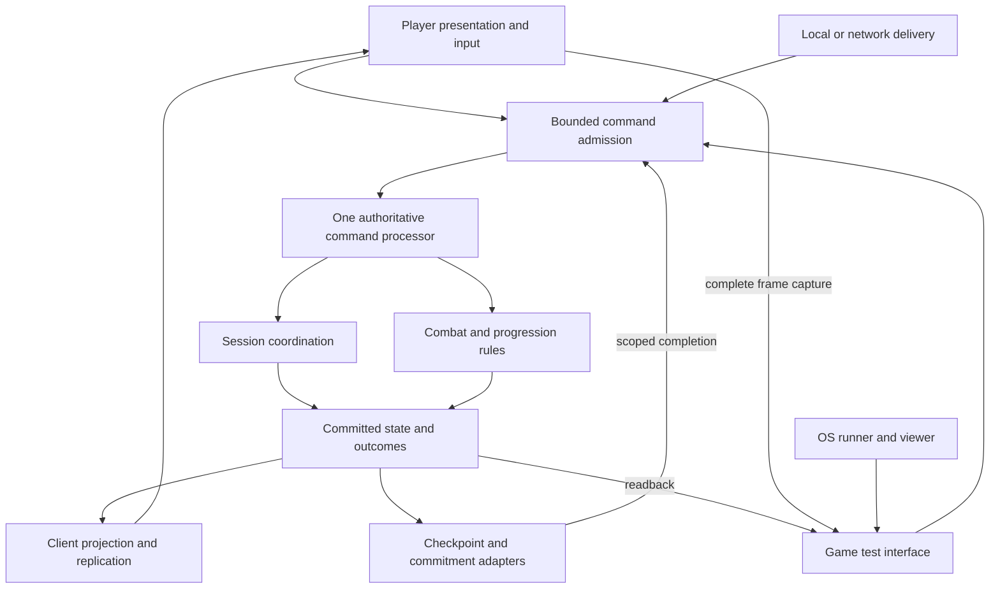

# Multiplayer ownership and implementation boundaries

**Design proposal, October 4, 2026.** Defines who owns state, how commands cross boundaries, and which small outcomes can be implemented and tested later. The owner requests thorough boundary design now and staged implementation later. The recommended centre is **one authoritative command processor using common gameplay rules for solo and co-op**, with presentation, connection services, persistence and desktop placement attached through bounded interfaces.

This serves the [foundation](../foundation.md)'s perceptible growth, distinct builds and responsive combat. It preserves accepted product rules and the [GDJ-6 revision 1 test contract](first-earned-level-up.md). Technical roles and production policies here remain proposals; requesting this design does not accept every proposed implementation choice. No runtime change, package/service selection, delivery estimate or validated networking envelope accompanies it. Linear owns priority/status, while these slices describe dependencies and verification.

## Existing commitments and evidence

The accepted product supports one to four players, beginning with two. Under the proposed integration, solo uses a local authority and one participant; co-op adds connections around the same rules and content. Authoritative player builds remain personal even though one host currently processes the party's state. Shared collected XP, independent offers/random streams, selected qualifying team grants, dead-player upgrade access, all-dead/waiting defeat and Retry remain accepted. Ordinary upgrade thinking stays unlimited; automatic disconnect waiting has **five minutes total per run**, with preserved late return. Detailed withdrawal, absence rewards, re-entry and host migration remain proposals in the [recovery design](cooperative-session-recovery.md).

Source baseline is **74c23e62f869fbc593d6e9f3809e153905d24d06**, with runtime unchanged from merged main **d63b532de33470d7498d2e450b5843840914f5ea**, Unity **6000.3.25f1** and Transport **2.7.4**. [Current state](../current-state.md) and [GDJ-20 evidence](../playtests/2026-10-04-shared-rifle.md) establish a fixed two-player/12-drone shared rifle fixture and connection-loss abort. Native performance/human acceptance remains pending. The accepted 35-drone earned-choice fixture is a design contract, not implemented progression. Neither fixture establishes four-player or dense network feasibility.

## Logical responsibilities

These are responsibilities and test seams, not a requirement for one class, assembly, service or process per row. A small first implementation can keep several roles together while preserving their ownership rules.

| Responsibility | Owns | Boundary contract |
| --- | --- | --- |
| Content and scenario configuration | Authored weapon/enemy/upgrade definitions, explicit test overrides, rules/content versions and initial settings | Produces validated immutable configuration. Does not contain earned player builds or transport addresses. |
| Session coordination | Original participant identities, lobby/config readiness, run binding, admission/withdrawal requests and phase eligibility | Routes transitions through the authoritative processor. A service roster or socket callback cannot directly change combat eligibility. |
| Authority command processor | One ordered mutation path for session/run transitions, control commands and simulation steps | Checks the current authority grant; serializes atomic transitions and returns committed outcomes. No UI/network/storage callback writes its state independently. |
| Combat rules | Movement acceptance, weapon cadence, hit resolution, HP/lives, enemy/projectile/pickup behaviour and encounter clocks | Consumes configuration, admitted participants and commands; produces state changes and immutable attribution. Local prediction cannot confirm damage. |
| Progression rules | Shared XP/levels, personal entitlements/offers/random state/build effects and explicit team reward events | Runs under the same writer. Ordinary choices affect their owner; team grants use declared recipients and once-only identities. |
| Client projection and replication | Read models, coherent baselines, state/event sequencing, per-peer subscriptions and traffic scheduling | Projects committed state without becoming a second game-state owner. A client view is smaller than an authority recovery record. |
| Connection and authority adapters | Local delivery or sockets, authentication/discovery/relay integration, and proof of exclusive hosting rights | Deliver bounded commands/connection facts. Discovery, delivery and authority selection are separate capabilities. |
| Checkpoint and commitment adapters | Coherent checkpoint storage, recoverability receipts, result deduplication and retention | Receive immutable data. Async completion is another scoped command; it cannot resurrect an old run or refill grace. |
| Presentation and ordinary input | Cameras, prediction/interpolation, local shot cues, HUD/menus/access settings and input mapping | Reads committed projections and submits intent. It never owns shared HP, progression, pause or terminal outcomes. |
| Game test interface and OS runner | Versioned game commands/readback/capture; external process/desktop/resource lifetime | The game owns scenario/control/state/capture semantics. The runner owns Win32 placement/lifetime and never manufactures gameplay success. |

The session/rule boxes execute inside the processor's ordered boundary. They are not concurrent writers. Transport traffic can arrive asynchronously; admitting it does not authorize an immediate mutation.

## Canonical state and identities

Keep three categories explicit: immutable content/configuration, authoritative session/run state, and local presentation/connection state. A player's ownership means they may select their own earned choices; it does not mean their client can upload arbitrary damage, XP or build values. The authority decides those effects.

| State or identity | Lifetime and writer |
| --- | --- |
| Session ID and original participant ID | Stable session/original-member identity maintained through authorized connection replacement. Display names, IP addresses and array slots are not identity proofs. |
| Frozen configuration revision and content/rules manifest | Validated during preparation and bound to Start/Retry. All admitted players acknowledge the same compatible configuration. |
| Run ID | New unique run identity on one committed Start/Retry. It survives same-run restore; a process restart cannot accidentally reuse an old run ID. |
| Authority term and restoration epoch | Authorized host generation plus an explicit new state baseline on restore. An older display tick cannot override newer authority/restore state. |
| Connection generation and operation ID | A generation binds the currently authorized connection. Stable participant/run operation IDs permit result replay across reconnect without repeating effects. |
| Simulation tick and commit index | Tick counts physical steps. Commit index orders state/control changes, including changes while physical time is frozen. Ordering includes authority/restoration context. |
| Life, weapon, enemy and pickup identities | Retain participant/weapon instances and life/incarnation generations. Reusing an array slot never reuses a live damage/collection identity. |
| Player build, offers and random streams | Authority-owned state keyed by original participant. Reconnect restores it; Retry resets run growth under its scenario policy. |
| Recovery expenditure and committed results | Metadata that cannot roll back with ordinary world checkpoints. Its recoverability/fault coverage is declared explicitly. |
| Camera, reticle, audio/access preferences and prediction buffers | Local presentation state. Compatible personal input options submit ordinary intent; they do not change authoritative weapon statistics. |

Use bounded collections keyed by stable IDs rather than assuming player A/B throughout the domain. Capacity four is a known boundary, while initial admission/validation supports one or two. Dense enemy IDs and pose history need bounded representations independently of party size. Do not require a server round trip or account service for solo's local command path.

## Configuration and pregame lobby

Create one versioned scenario/configuration description consumed by solo and shared runtime paths. It identifies rules/content, seed/random algorithm, tick policy, arena/threat/starting weapon settings, roster limits and selected lifecycle/progression policies. Developer overrides are explicit scenario data; connection endpoints and local display settings belong outside it. Effective weapon values are derived from starting definitions plus authoritative per-player build effects, so the host can validate cadence/damage after growth.

Preserve intentional fixture differences. The local precision control has 40-HP drones; GDJ-20 has 12 shared 60-HP drones; accepted GDJ-6 uses 35 60-HP drones and one ordinary earned choice. Those are named scenarios, not a rule that multiplayer silently changes enemy HP. Show the selected scenario and meaningful test settings before launch. Normal game options and developer damage/rate/HP overrides have separate presentation; production defaults and difficulty scaling still require owner/play evidence.

The proposed pregame flow is Prepare → Validate configuration/content and participant bindings → Ready for that revision → Commit Start once. Changing gameplay configuration invalidates readiness for the previous revision. Freeze configuration at Start; run upgrades change player build state rather than edit lobby settings. A participant ready for an old configuration cannot start a newer one. Cancellation/admission changes are serialized with Start, which either binds the approved roster/configuration or remains in preparation.

Solo can prepare and start locally through the same validation path without waiting for a network party. Direct-address friend sessions are enough for the first co-op lobby; discovery/invites/relay remain connection adapters. Unity's [Lobby/Relay distinction](https://docs.unity.com/en-us/mps-sdk/advanced-config/relay-vs-lobby) separates grouping/configuration from message delivery; neither service is the combat authority by itself. No service has been selected here.

Lobby readiness, upgrade-Zone readiness and Retry readiness are separate command purposes. Lobby Ready names a configuration/roster revision; Zone Ready names its phase/membership revision; Retry Ready names the ended run and selected next-run configuration. Reusing a single unexplained boolean would allow old readiness to start or resume the wrong state.

## Commands and clocks

Use one admission path for local player, remote player and ordinary test input. A connection maps to an authorized participant before processing; clients cannot choose another participant ID in a packet. Bound message types/sizes/rates, validate role, run, term/epoch, generation, sequence and applicable phase/offer/target before mutation. Stable operation results make duplicate requests idempotent. Unknown/malformed pre-admission traffic cannot trigger a party pause or terminal outcome.

Combat command examples are movement/aim intent and shot intent with bounded pose context. Progression commands choose a concrete offer option/target rather than submit an invented upgrade definition. Session commands include configuration change, Ready, Start/Retry and authorized admission/withdrawal. Exposing diagnostic reset/forced-state commands requires an explicit local test mode and labelled evidence; remote game participants do not receive generic authority-write access. Existing trusted-position reporting is a fixture constraint; production movement validation/prediction must be selected and tested through this boundary.

Define these minimum interface shapes before selecting a wire codec or C# types:

| Interface | Required request and outcome |
| --- | --- |
| Configure and Start | Validated configuration/roster revision and participant acknowledgement produce one frozen configuration/run binding; mismatch/stale readiness leaves preparation intact. |
| Submit command | Bound actor, session/run, authority/restore/generation context, stable operation/sequence and typed bounded payload produce Pending, Applied or Rejected with operation ID, current commit/tick context and an explicit result/reason. Transport receipt alone is not Applied. |
| Read or replicate projection | An authorized view request/subscription produces immutable state/events identified by configuration, authority/restore context, commit index and simulation tick; it has no writable authority reference. |
| Capture and store checkpoint | A coherent cut/manifest plus declared fault coverage produces a complete verified checkpoint and recoverability receipt, or explicit pending/failure. Its async receipt is checked against the current run/epoch before changing recoverability state. |
| Obtain authority and admit participant | A validated exclusive authority grant and original-member proof produce a new authorized binding/baseline, or refusal/interrupted status; a socket or lobby-owner label alone is insufficient. |

Pending requests reserve their operation identity rather than executing again on retries. Applied means the selected mode's authority committed the effect; a separate declared recoverability watermark/receipt is necessary for host-crash-safe confirmation. Rejection spends no choice or grant and carries a usable reason. UI can translate these outcomes into ordinary pending/confirmed/error feedback without exposing internal protocol fields. Bound request queues, result retention and per-frame dispatch work as part of each interface, so malformed or slow peers cannot monopolize the ordered processor.

| Clock or ordering | During Recovery or upgrade thinking |
| --- | --- |
| Physical simulation ticks | Stop movement, attacks, enemies, projectiles, collection, duration, cooldowns, timed effects and active-time life/return clocks. Resume without catching up five minutes of simulation. |
| Authoritative control commits | Continue validated upgrade/menu/readiness, membership, recovery acknowledgement and terminal/phase transitions that are legal in that state. Increment commit index even if simulation tick is unchanged. |
| Networking and wall-clock recovery allowance | Continue connection detection, authentication, transfers and deadline accounting. Charge recovery-caused frozen countdowns; overlaps count once and old checkpoints cannot refill the allowance. |
| Presentation/capture | Continue UI, narration, connection feedback and frame delivery under declared overhead budgets. Local focus loss is an input condition, not automatically a global pause. |

The processor uses a defined physical tick order for the selected scenario, rather than the order socket callbacks happen to arrive. Accepted GDJ-6 applies queued choices before due shots, then evaluates defeat/completion before revival/collection/entitlements. Preserve its exact ordering while it is the active test contract. Future Zone control commits can apply mental decisions while physical clocks are frozen; this needs a separate control revision instead of pretending each change advanced encounter time.

Membership/deadline changes also require an ordered control boundary while frozen. The [recovery contract](cooperative-session-recovery.md#the-zone-readiness-and-endings) proposes expiry/withdrawal → terminal evaluation → late admission → readiness/pause recomputation. A stale acknowledgement cannot defeat the deadline. Legitimate upgrade thinking stays unlimited when its independent reason remains active. Departed/withdrawn eligibility and absent life timers need explicit policy rather than reading a slot's HP to infer membership.

## Combat and progression effects

Keep authoritative rules usable under a local or remote command adapter. A gradual extraction may share configuration and one rule at a time; it need not replace the optimized benchmark simulation or move every Unity type into a new library. Desktop/window/GUI/network calls stay outside rules. Rendering may use engine data and specialized simulation backends, provided the chosen gameplay inputs/outcomes and evidence remain coherent.

Combat produces immutable hit/death records with run, source participant/weapon/shot, enemy identity/incarnation, requested and actual damage, region and before/after HP. Prior shots retain their damage snapshots when a build changes. Cadence validation uses authoritative effective weapon state. A local shot cue is responsive presentation; confirmed hits/kills, damage and orb creation come from committed outcomes.

Progression keeps world pickup consumption, shared XP/level, personal entitlement, concrete offer, selection and applied effects distinct. Orb collection is once-only and does not become private collector XP. Offer generation uses that participant's legal targets and personal random stream; reopening, dying or reconnecting preserves an already disclosed offer. Use explicit serializable random state/algorithm versions for recovery rather than reseeding from the original seed; random game draws and security credentials are different concerns.

An effect names its domain and target: weapon instance/trait, player pickup range or another declared player effect, loot policy, or future draw policy. Implement only the first damage/cadence effects initially. Revalidate the offer/target at selection without silently granting a missing trait or rerolling another player's choices. Compatibility changes, pending-offer timing and empty pools retain their [existing open rules](progression-and-upgrade-pools.md#weapon-traits-and-offer-eligibility).

For a qualifying team grant, create one reward event with source credit, explicit recipient policy/version and per-recipient effect/result IDs. Receiving it never creates another pull or recursively shares it. Preserve other personal offers. Qualifying tiers, incompatible recipients, withdrawn/dead eligibility and modifier ordering remain GDJ-13/GDJ-14 questions; GDJ-6's first pool continues to exclude qualifying rare content.

The first fixture's authoritative confirmation covers a surviving host process. A host-crash-safe mode needs a separate recoverability boundary: confirmed choice/result plus deduplication record must survive the declared fault domain before being advertised as recoverable. Storage/replica completion returns through command admission, revalidating run/epoch and any pending-operation/terminal policy. Define pending choice reservation, rejection and terminal-race behaviour before that mode; an asynchronous acknowledgement cannot apply an upgrade after defeat. Do not add a remote durable write to every combat tick merely to satisfy rare choice/result durability.

## Replication and recovery

Separate client view baselines from complete authority checkpoints. A player needs visible world state, their authorized offer/build/menu state and shared outcomes. A checkpoint additionally needs all authority-only clocks, random streams, queues or invalidation decisions, IDs, commitments, membership/pause/budget metadata and configuration. Never distribute reconnect secrets in ordinary client baselines. Recovery manifests identify compatible schema/content and verified complete state; incompatible or partial state is not playable continuation.

Replication observes committed state and decides bounded delivery cadence/subscriptions; it does not recompute XP, choose upgrades or declare deaths independently. Control commits during a pause must still reach clients even though physical tick is unchanged. Late admission transfers an immutable baseline, then ordered changes after its cut, before a generation-bound activation acknowledgement. Budget assembly/catch-up history and invalidate transfers on Retry, authority/restore changes or terminal outcome. A slow peer stays withdrawn when catch-up cannot converge; do not stop everyone repeatedly to mask that failure.

Bulk/checkpoint work gets explicit per-peer and aggregate bandwidth, CPU, queue and memory budgets. Prioritize live control/combat; backpressure is a bounded delivery condition, not a shared defeat/abort. Current full enemy encoding extrapolates to 12 MB/s per client at 10,000 enemies/60 Hz before overhead, as the [reviewed cost model](cooperative-session-recovery.md#late-admission-and-traffic-budgets) explains. Fixed pair/12-drone recovery cannot establish the >10,000-enemy target; select and measure dense replication/pose-history/serialization separately.

Same-host reconnect, authority checkpoint restore, and exclusive host replacement are distinct interfaces and failure guarantees. First recovery work keeps the host alive. Automatic migration needs an exclusive authority grant that an isolated old host can lose safely, plus complete transferable state; an unreachable two-peer host is not permission for both peers to self-promote. If authority cannot be established before automatic allowance expires, show interrupted recovery options. Interrupted UI/dormant state is recoverable when records permit; committed Defeat/Complete is final. See the [host-loss contract](cooperative-session-recovery.md#host-loss-continuity-needs-authority-state). No election/backend/durable-storage provider is selected.

The initial solo/same-host mode binds authority to the explicit session creator and disables automatic replacement. Its grant can be a local/session binding; it does not require an external election service. Losing that authority uses the selected fixture's abort or interrupted-recovery policy. Enabling replacement is a later stage with the stronger exclusive-grant/state-transfer contract, not an implicit capability of the initial adapter.

## Ending and Retry

The run authority evaluates shared endings under the selected participant policy. The accepted condition is all players dead/waiting, even with pending timers; applying it after withdrawal depends on the recovery draft's still-proposed active-membership interpretation. Closing a transport, losing focus or showing Interrupted cannot independently award completion or invent defeat. Stop further encounter actions/effects after a committed terminal transition; preserve its result and attribution.

Retry is one authority transaction after the selected readiness rule, allocating a new run ID and resetting that scenario's combat/build/XP/offer/random/feedback/pending/readiness state once. Reject all commands from the previous run. Keep local access preferences. Configuration changes for a new run return through preparation/compatibility/readiness; they cannot be smuggled into an old Retry acknowledgement. The fixed test's all-roster Retry remains accepted for that scenario, while production absence/readiness rules are still proposed.

Persistent discovery/unlocks are a future consumer of an explicit committed result, with original-player ownership and once-only award keys. They do not become a current cloud/account/meta-system dependency. The parked permanent-power matrix and optional cameras remain outside MVP/alpha.

## Presentation and test environment

Presentation consumes local/read-model state and submits commands for the local participant. Reset prediction/interpolation and feedback on a new run/life/restoration baseline; restored authoritative placement wins over an old client position. Menus display active configuration, pending versus confirmed choices, current phase and who is away. Keep networking diagnostics in developer evidence rather than requiring ordinary players to understand authority terms or commit indexes.

[GDJ-21](https://linear.app/cnid/issue/GDJ-21/build-a-portable-game-test-interface-with-a-windows-background-runner) owns the selected portable game test interface and thin native Windows runner. The interface exposes bounded ordinary input, scenario lifecycle requests, receipts/readback and complete-frame capture. It routes gameplay through ordinary command/rule paths and makes deliberate fault setup visible in evidence. Capture/presentation costs are measured separately from native visible release acceptance.

The external runner owns process trees, Win32 desktops, ports and resource cleanup. It can interrupt a process/link as a labelled failure test, but cannot substitute for player identity, lobby readiness, game state ownership or authority recovery. A later Linux runner can attach to the same interface; OS choice does not change gameplay policy. One-PC loopback tests prove their observed process/protocol behaviour; real network path/machine loss and low-end/dense performance require separate evidence within the chosen support envelope.

## Adapting the current code

| Current source | Existing responsibility and proposed extraction |
| --- | --- |
| [PrototypeGame](../../prototypes/001-stacked-weapons/Assets/Prototype/Runtime/PrototypeGame.cs) | Local orchestration/menu/input and solo rate setting; StartShared disables it and starts a separate path. First pass shared validated configuration to both, preserving named controls. |
| [CombatSimulation](../../prototypes/001-stacked-weapons/Assets/Prototype/Runtime/CombatSimulation.cs) | Solo/reference/batched simulation and rate/cooldown behaviour. Extract/share bounded gameplay parameters/rules without discarding measured backends. |
| [SharedGame](../../prototypes/001-stacked-weapons/Assets/Prototype/Runtime/SharedGame.cs) | Transport receive, input/prediction, authority stepping, publishing, UI and evidence currently combined. Introduce explicit command/read-model seams gradually; keep release/reference reproduction. |
| [SharedEncounter](../../prototypes/001-stacked-weapons/Assets/Prototype/Runtime/SharedEncounter.cs) | Host-only combat/lifecycle with two-player arrays, fixed tuning, history and host-only state. Retain one mutation owner while introducing configuration, stable roster IDs and complete recovery state. |
| [SharedConnection](../../prototypes/001-stacked-weapons/Assets/Prototype/Runtime/SharedConnection.cs) | One peer, protocol-only Hello, 1,100-byte packets and one reliable ordered pipeline. Keep it a bounded fixture adapter until authenticated multi-peer/traffic contracts are explicitly implemented/tested. |
| [SharedPreview](../../prototypes/001-stacked-weapons/Assets/Prototype/Runtime/SharedPreview.cs) and [background runner](../../tools/background_desktop.py) | In-game camera/control preview and external placement/lifetime. GDJ-21 improves the interface/full frame without moving session authority into the viewer. |

This proposal does not change the original control archives, pinned editor/packages or GDJ-20's accepted disconnect-abort fixture. A recovery scenario needs its own explicit policy/configuration and evidence before replacing that expectation.

## Small implementation outcomes and checks

Each row is a candidate focused outcome, not a new task board or promise to implement everything before the next playtest. Linear chooses scheduling. Progression and recovery have separate dependencies; the first earned-choice test can keep its accepted live selection/abort rules while later Zone/recovery work is developed. Keep one implementation active and split a row again if it becomes too large.

| Outcome | Depends on | Minimum evidence before extending it |
| --- | --- | --- |
| Close the existing shared-combat gate | Current GDJ-20 candidate/evidence | Pending native visible frame/feedback and human role/lifecycle findings; preserve revise-before-progression. This design supplies none of them. |
| Common configuration and scenario display | Current solo/shared controls | Same explicit configuration reaches both paths; intentional 40/60 HP and 12/35 count fixtures remain labelled; reference smokes and owner expectation check. |
| Common command/state ownership seam | Validated configuration | One ordered writer, stable run/player/life/operation identity and a shared first weapon/lifecycle rule; local versus pair semantic parity under matching scenarios. |
| Minimal pair lobby and compatible start | Identity/configuration/admission seam | Config edit cancels old readiness; mismatch/duplicate Start/leave race cannot start a partial roster; solo starts locally; scoped negative-message checks. |
| First earned-choice experiment | Shared-combat acceptance and applicable common-rule seams | Exact GDJ-6 chain: collection → shared level → independent offer/choice/effect → observed damage/cadence → death/ending/Retry. Test ordinary effects only and preserve the accepted ordering. |
| Upgrade Zone | Explicit clocks/control revisions and progression | Physical clocks/actions stop; menu commits/network continue; offers persist; phase-bound readiness resumes correctly; accessible presentation/human waiting evidence. |
| Same-host recovery | Authenticated identity, membership/pause/control revisions and coherent admission | Pair/12-drone trial: total budget, early/expired/late return, state preservation, duplicate/stale/racing commands and nested pause/terminal checks. No host-crash claim. Add an earned-build combination as a separate focused check. |
| Complete checkpoint restore | Versioned state/random/IDs and chosen store fault coverage | Coherent capture, restore parity, crash before/after recoverable confirmation, nonrollbackable budget/results and retention failure; declared bytes/time/memory budgets. |
| Safe host replacement | Checkpoint restore and validated authority-grant adapter | Kill and partition separately; isolated old host stops; one canonical result; correct no-grant/deadline fallback; no two-peer timeout self-election. |
| Four-player lifecycle | Bounded roster/multi-peer and current applicable feature contracts | Three-client admission/withdrawal/choices/readiness/Retry parity, fair bulk work and no slot assumptions; do not infer tuning from pair results. |
| Dense network envelope | Chosen replication/pose-history/capture strategy | Representative network CPU/bandwidth/latency, peak memory and visible release frame/feedback percentiles at declared entity/effect/party counts; preserve equivalence counters and reference modes. |

Failure injection should distinguish packet loss/reorder/duplication, a connection drop, slow catch-up, process crash, machine loss and an unavailable authority/store. Record command/operation identities, configuration/build/source, committed outcomes, transfer/work counters and exact fault timing. Human clarity/fun remains separate from consistency, and a camera preview is not native performance evidence. The [recovery handoff](cooperative-session-recovery.md#bounded-implementation-and-verification-handoff) contains its detailed failure cases.

## Decisions needed before each extension

| Open decision | Boundary it affects |
| --- | --- |
| Common production defaults and party-size/difficulty policy | Configuration/rules; no automatic difficulty reduction merely inferred from a disconnected socket. Existing test values remain explicit. |
| Production death/withdrawn timer, readiness and active-membership eligibility | Session/control/life rules; preserve accepted all-dead defeat and no indefinite disconnected veto. GDJ-13 reviews the proposed interpretation. |
| Rarity tiers, recipient compatibility, absent rewards and pending-offer/modifier timing | Progression/grants; GDJ-14 and existing trait/pool research remain unresolved. |
| Zone invocation/checkpoint cadence, choice UI/access and loadout scope | Control/physical pause boundary and presentation; unlimited legitimate thinking remains accepted. |
| Remote movement/prediction/pose acceptance and supported network conditions | Combat admission and projection; trusted loopback position reporting is not an Internet security/latency guarantee. |
| Exclusive host grant, authentication/discovery/relay and threat model | Connection/authority adapters; trusted host co-op does not prevent the host fabricating results. No package/service selection here. |
| Which faults confirmations/checkpoints survive, allowable world rollback, pending-operation terminal rules and dormant lifetime | Commitment/restore/retention; no host-crash or zero-loss promise without the selected recoverable boundary. |
| Network/checkpoint/assembly/ledger/history limits and dense replication strategy | Delivery/storage/simulation scheduling; 144 FPS and dense co-op require measured workload/hardware limits. |

## Resume

Documentation verification: full read-back and source/configuration cross-check; nine changed Markdown files have 173 valid local links, including 17 heading anchors, with no unresolved targets or unclosed code fences. Whitespace checks pass. Runtime files remain unchanged from merged main; no Unity build, runtime test or performance capture applies to this documentation-only change.

Start from this proposal and the accepted foundation, then the selected Linear outcome's latest source/evidence. The boundary design is ready for review, not an accepted complete C# architecture. No implementation or runtime tests have been performed for it. Use the source map and outcome table to scope one slice, state its supported failure/workload envelope, and verify its boundary before growing it. Keep GDJ-20's pending acceptance, GDJ-6's accepted contract, GDJ-7/GDJ-13/GDJ-14's open policies and GDJ-21's runner scope explicit. Review changes in the existing draft PR; commit/check/link details are saved in Linear at handoff.
