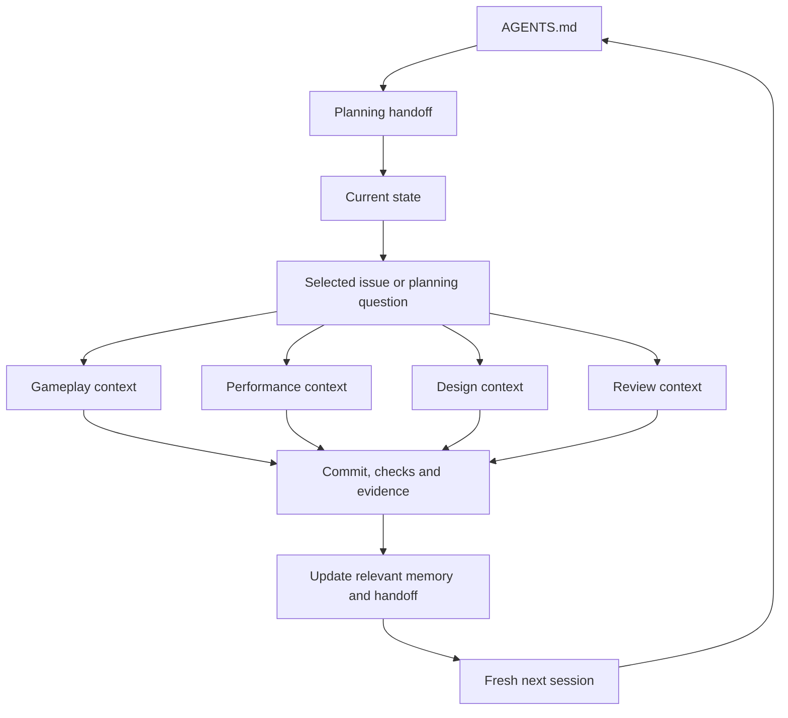

# Planning handoff

Updated October 2, 2026. Read this and [current state](../current-state.md) at the start of every fresh planning or task session. These are the small shared root; follow only the links needed for the current outcome. Check the actual checkout/commit and task brief before acting. Current user instructions take precedence over recorded plans.

Use the [planning/integration startup prompt](start-planning-session.md) to begin a fresh coordination session. It loads this root, checks the repo/board and prepares the next bounded task brief.

## Direction and reasoning

Our first game tests whether stacking distinct weapons creates satisfying power growth while threats remain readable. The crowd investigation reduced a major technical risk, but the enjoyment question is still open. Carry the measured work forward deliberately, then return to a small playable weapon/upgrade loop. See [the game brief](../design/game-brief.md) and [milestone outcomes](../roadmap.md).

The [Game Dev (GDJ) Linear project](https://linear.app/cnid/project/first-weapon-stacking-playtest-89b5952f722e) owns live task priority, status and dependencies. Preset validation and observation of the current rifle are the entry points before weapon expansion. Consult the board for what is ready; this page records intent rather than a second task queue.

## Accepted working choices

- Planning/integration is a repeatable role. Start a fresh session for a new planning decision or bounded task; any session can resume from committed files without earlier dialogue.
- Keep one implementation task active. Gameplay, performance, design and review are context branches we use when needed; they do not require four simultaneous chats or agents.
- GitHub holds source, accepted design/decisions and evidence. Linear holds the live queue. Chats hold temporary reasoning; save the useful project facts and outcomes before ending a session.
- Keep the root concise. Link detailed rationale/history, task plans and raw evidence instead of copying them into every brief. [Workflow](../workflow.md) covers checks and completion.

## Follow the relevant branch

| Task | Read after this root and current state |
| --- | --- |
| Planning/integration | Selected Linear issue, [roadmap](../roadmap.md), relevant [design](../design/game-brief.md) or [decision](../decisions/README.md); completed task handoff/evidence. |
| Gameplay | Selected issue, [prototype specification and code map](../../prototypes/001-stacked-weapons/README.md), affected code/tests; relevant design or playtest findings. |
| Performance | Selected issue, [policy](../performance.md), [profiling protocol](../profiling.md), [latest renderer evidence](../playtests/2026-09-30-renderer-experiments.md), affected simulation/rendering code. |
| Design/reference | The precise player question, [game brief](../design/game-brief.md), relevant reference study or human observations. |
| Review/playtest | Exact candidate commit/diff/build, issue acceptance, checks already run and [playtest questions](../../prototypes/001-stacked-weapons/README.md#evidence-and-exit-decision). |

## Write back, then start fresh

At a useful checkpoint and before ending a session, preserve the result, exact source/build/configuration, checks, unresolved questions and next action in the issue and relevant repo record. Update this page when intent or accepted choices change; update current state when capabilities or constraints change. Small changes do not need a new session log or decision document.

For work spanning sessions, add a short Resume section to the issue. Use `docs/planning/tasks/<issue-id>.md` only when a longer execution/resume plan earns its place; link it from the issue. See the [brief and resume template](task-brief-template.md). Never depend on a previous chat being readable or on a compaction retaining every detail. A branch means selecting relevant context, not reading the entire tree.

## Questions still requiring evidence

- Does the current rifle/movement slice feel promising enough to expand?
- Does the measured rendering preset hold up under staggered attacks and endurance, and which options should be promoted?
- Do three weapons create readable power growth and different build strengths?

The [saved planning discussion](sessions/2026-10-02-solo-ai-system.md) records why we chose fresh sessions. The [journey review](2026-10-02-development-system.md) preserves the earlier path; neither is required reading for every task.
