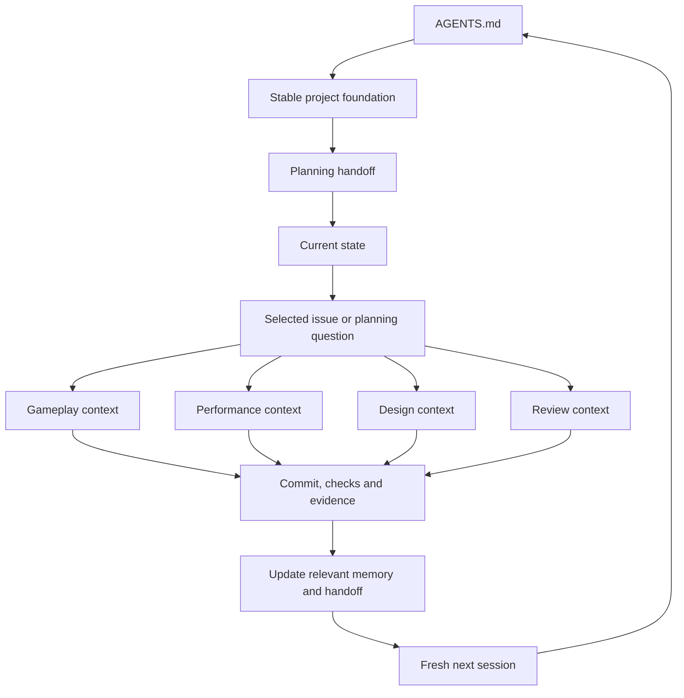

# Planning handoff

Updated October 2, 2026. Read the [project foundation](../foundation.md) first, then this handoff and [current state](../current-state.md) at the start of every fresh planning or task session. The foundation defines what the game is; this page defines near-term plans for building it. Follow only the links needed for the current outcome. Check the actual checkout/commit and task brief before acting. Current user instructions take precedence over recorded plans.

Use the [planning/integration startup prompt](start-planning-session.md) to begin a fresh coordination session. It establishes the game definition first, checks the repo/board, then prepares a bounded task brief tied to the game's systems and pillars.

## Direction and reasoning

Our game tests whether stacking distinct weapons creates satisfying power growth and useful team combinations while threats remain readable. The owner has changed the product to **cooperative PvE for 2-4 players, two-player testing first**, with **isekai into an AI-controlled world**; see [decision 0002](../decisions/0002-cooperative-pve-ai-world.md). The local crowd investigation reduced a rendering/simulation risk, but multiplayer feasibility and enjoyment remain open. Carry that evidence forward as a local control. See [the game brief](../design/game-brief.md) and [milestone outcomes](../roadmap.md).

The [Game Dev (GDJ) Linear project](https://linear.app/cnid/project/first-weapon-stacking-playtest-89b5952f722e) owns live task priority, status and dependencies. Preset validation and observation of the current rifle are the entry points before weapon expansion. Consult the board for what is ready; this page records intent rather than a second task queue.

The owner's current October 2 direction is **design first**, developing the selected **Engine Kingdoms** world: an AI maintains a magical world, and outsiders combine forbidden powers. Use the [GDJ-6 design-session brief](tasks/GDJ-6.md) and [world comparison](../design/ai-world-options.md) to describe one 60-second cooperative encounter. The exact signature effect remains a hypothesis. Then scope minimal two-player network/combat feasibility before broadening the weapon/progression experiment. This supersedes the earlier recommendation to start with the rifle playtest; the [GDJ-2 brief and inspection checkpoint](tasks/GDJ-2.md) remain available as local evidence for later. Existing playtest/preset checks remain useful, but cannot establish cooperative acceptance. Re-scope the later tasks from the design/feasibility handoff before starting them.

## Accepted working choices

- Planning/integration is a repeatable role. Start a fresh session for a new planning decision or bounded task; any session can resume from committed files without earlier dialogue.
- This chat's role is to orchestrate the other task chats: choose and scope outcomes, prepare briefs, coordinate authorized sessions, review their durable handoffs and integrate accepted results. Bounded design and implementation work belong in task chats. Create or message those chats only when the owner explicitly asks; otherwise provide the brief.
- Keep one implementation task active. Gameplay, performance, design and review are context branches we use when needed; they do not require four simultaneous chats or agents.
- GitHub holds source, accepted design/decisions and evidence. Linear holds the live queue. Chats hold temporary reasoning; save the useful project facts and outcomes before ending a session.
- Keep the root concise. Link detailed rationale/history, task plans and raw evidence instead of copying them into every brief. [Workflow](../workflow.md) covers checks and completion.

## Follow the relevant branch

| Task | Read after the foundation, this handoff and current state |
| --- | --- |
| Planning/integration | Selected Linear issue, [roadmap](../roadmap.md), relevant [design](../design/game-brief.md) or [decision](../decisions/README.md); completed task handoff/evidence. |
| Gameplay | Selected issue, [prototype specification and code map](../../prototypes/001-stacked-weapons/README.md), affected code/tests; relevant design or playtest findings. |
| Performance | Selected issue, [policy](../performance.md), [profiling protocol](../profiling.md), [latest renderer evidence](../playtests/2026-09-30-renderer-experiments.md), affected simulation/rendering code. |
| Design/reference | The precise player question, [game brief](../design/game-brief.md), relevant reference study or human observations. |
| Review/playtest | Exact candidate commit/diff/build, issue acceptance, checks already run and [playtest questions](../../prototypes/001-stacked-weapons/README.md#evidence-and-exit-decision). |

## Write back, then start fresh

At a useful checkpoint and before ending a session, preserve the result, exact source/build/configuration, checks, unresolved questions and next action in the issue and relevant repo record. Update this page when near-term intent changes; update current state when capabilities or constraints change. Use the [project-direction process](../workflow.md#changing-project-direction) for changes to the game's identity or agreed boundaries. Small changes do not need a new session log or decision document.

For work spanning sessions, add a short Resume section to the issue. Use `docs/planning/tasks/<issue-id>.md` only when a longer execution/resume plan earns its place; link it from the issue. See the [brief and resume template](task-brief-template.md). Never depend on a previous chat being readable or on a compaction retaining every detail. A branch means selecting relevant context, not reading the entire tree.

## Questions still requiring evidence

- Which concrete cooperative signature and visual treatment best express The Engine Kingdoms weapon-stacking fantasy? Detailed design proposals remain hypotheses until selected and tested.
- Can two players share responsive, consistent combat, hit results and a run ending/restart? Network ownership, upgrade timing, downed rules and multiplayer performance are unverified.
- Does the current rifle/movement slice feel promising enough to expand?
- Does the measured rendering preset hold up under staggered attacks and endurance, and which options should be promoted?
- Do three weapons create readable power growth and different build strengths?

The [saved planning discussion](sessions/2026-10-02-solo-ai-system.md) records why we chose fresh sessions. The [journey review](2026-10-02-development-system.md) preserves the earlier path; neither is required reading for every task.
