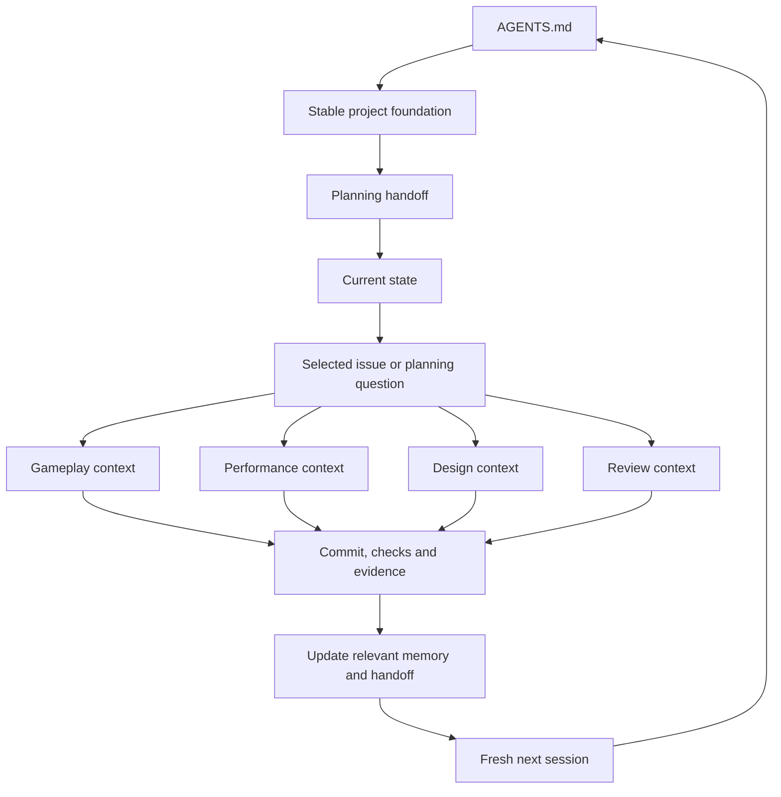

# Planning handoff

Updated October 4, 2026. Read the [project foundation](../foundation.md) first, then this handoff and [current state](../current-state.md) at the start of every fresh planning or task session. The foundation defines what the game is; this page defines near-term plans for building it. Follow only the links needed for the current outcome. Check the actual checkout/commit and task brief before acting. Current user instructions take precedence over recorded plans.

Use the [planning/integration startup prompt](start-planning-session.md) to begin a fresh coordination session. It establishes the game definition first, checks the repo/board, then prepares a bounded task brief tied to the game's systems and pillars.

## Direction and reasoning

**GDJ-20 stage-one candidate, October 4:** the owner authorized [shared rifle combat/lifecycle](tasks/GDJ-20.md) after accepted GDJ-6 revision 1. Host/client authority and real loopback damage/death/reset are implemented in a draft candidate, with 95 Edit Mode/eight Play Mode, clean release builds and exact 60-second standalone parity. Owner-selected testing uses two processes and an automated companion without another person/hardware dependency. The requested Win32 background desktop and in-process preview/control bridge now let P1 keep using the main desktop; a smoother viewer delivers about 26 frames/s from each camera. Accepted controls rehash unchanged and reference smokes pass. [Exact results](../playtests/2026-10-04-shared-rifle.md) distinguish this preview from pending native visible-budget and human combat-feel acceptance. **Revise before attaching progression** until those gates are resolved. LAN/internet remain unverified; this stage does not complete the earned-level-up contract.

**Accepted first earned level-up contract, October 4:** the owner accepts [GDJ-6 revision 1](../design/first-earned-level-up.md), exact content `abde9100e03165f3437f739d40e265c05f52219c`, as the test contract: “Let's accept revision 1 as the test contract, it looks good.” It specifies collection-required shared XP, one independent personal damage/cadence choice, explicit solo/dead participation, ending and shared retry/reset. Values/intended effects remain hypotheses; live selection is a temporary simplification and qualifying rares are excluded while accepted thinking-space/shared-grant rules remain intact. The bounded design outcome is complete. [The prepared staged feasibility brief](../design/first-earned-level-up.md#one-bounded-technical-feasibility-handoff) first investigates shared rifle combat/lifecycle with 12 drones before attaching earned progression. Authority, package, hosting and budgets remain to investigate. No implementation chat or gameplay/network evidence accompanies acceptance; broader expansion still follows cooperative feasibility.

**Accepted rifle feedback, October 4:** the [GDJ-2 baseline](../playtests/2026-10-03-rifle-baseline.md) records at least two active attempts, pause/full reset and a revise-before-stacking decision. P1 now accepts the [GDJ-16 overhead-HP candidate](../playtests/2026-10-03-overhead-health.md) and authorizes merging it: no cyan brackets, consistently amber wounded HP above heads, damaged-only visibility/stable owners and clearer damage/death cues. Existing head-clearance/visibility/rendering checks and the release build pass; no new detailed play metrics or performance result. A full-health boss exception remains future policy.

**Latest accepted integration:** P1 accepts [GDJ-15's aiming fix](../playtests/2026-10-04-shot-alignment.md) as smooth and undelayed, then tests and accepts [GDJ-19 testing/benchmark fire-rate controls](tasks/GDJ-19.md) and authorizes integration. [The rate report](../playtests/2026-10-04-rifle-rate-controls.md) preserves exact source, checks and acceptance. PR #5/#6 are merged into main `888a32d`. The owner then dispatched [GDJ-17 target highlighting and 2× critical head hits](tasks/GDJ-17.md) as the bounded implementation task. Its [exact release candidate](../playtests/2026-10-04-precision-aim.md), source `2e72121`, passes 77 Edit Mode/seven Play Mode, release build and reference smokes. P1 accepts the presented slow/rapid healthy/wounded precision comparison: “Yes, that all looks good.” The owner explicitly authorizes commit/PR/merge, and [PR #8](https://github.com/OpenCnid/game-dev-journey/pull/8) merged at `a90c61986721a7d280cda07dbccce05934b21f13`. The coordinator can select the next bounded task from Linear; no new performance result. [GDJ-18 customization/sharing](../design/crosshair-customization-and-imports.md) remains separate. Ammo, target-gated autofire, jumping and ranged threats remain saved requests. Traits/upgrade pools remain deferred; GDJ-1 retains its independent preset gate.

**Historical baseline-first correction, October 3 (fulfilled by accepted rifle revisions):** observe the existing rifle before assigning traits or a concrete upgrade pool. The owner challenged deeper weapon design before sufficient testing of the gun itself. [GDJ-2's baseline playtest brief](tasks/GDJ-2.md) already owns human observations and a proceed/revise decision. Keep accepted world/core/eligibility direction and future proposals saved; use the baseline findings to choose one bounded revision or progression experiment. Detailed GDJ-6 weapon/encounter rules are not a prerequisite for this existing local-rifle check. No build, play session or other chat is launched by this documentation handoff.

Our game tests whether stacking distinct weapons creates satisfying power growth and useful team combinations while threats remain readable. The owner has changed the product to **bullet-heaven survival roguelite for 1-4 players, solo or cooperative PvE, two-player cooperative testing first**, with **isekai into an AI-controlled world**; see [decision 0002](../decisions/0002-cooperative-pve-ai-world.md). The local crowd investigation reduced a rendering/simulation risk, but multiplayer feasibility and enjoyment remain open. Carry that evidence forward as a local control. See [the game brief](../design/game-brief.md) and [milestone outcomes](../roadmap.md).

The [Game Dev (GDJ) Linear project](https://linear.app/cnid/project/first-weapon-stacking-playtest-89b5952f722e) owns live task priority, status and dependencies. Preset validation and observation of the current rifle are the entry points before weapon expansion. Consult the board for what is ready; this page records intent rather than a second task queue.

The owner's direction is **immediate combat and progression**: one gun, shared team XP, independent personal random choices/pool modifiers, and large-stack growth. Teammate draws may overlap. Selecting a qualifying high-rarity upgrade grants it to the team and credits the original player; appearance in an offer alone does not grant it. Future upgrades can affect loot/draws as well as weapons; see [decision 0003](../decisions/0003-shared-xp-personal-upgrade-draws.md) and [progression design](../design/progression-and-upgrade-pools.md). On October 3 the owner accepted **party thinking space as a future feature**, combining planned breaks with earlier invocation, unlimited mental choice time during physical freeze and readiness-based resume. [Decision 0004](../decisions/0004-party-thinking-space.md), the Party thinking space Linear milestone and [GDJ-7](https://linear.app/cnid/issue/GDJ-7/build-party-thinking-space-for-cooperative-upgrades) preserve later work. Exact cadence/loadout/draw/lifecycle handling remains open. The [encounter record](../design/engine-kingdoms-first-encounter.md) and [session brief](tasks/GDJ-6.md) preserve the 60-second survival proposal and remaining qualifying-tier/applicability and lifecycle rules. Further lore and special combinations are deferred. After baseline rifle observations, resolve only the rules needed by the next bounded progression/shared-combat experiment. Existing [rifle/preset evidence](tasks/GDJ-2.md) cannot establish cooperative acceptance; re-scope later work from the handoff.

## Accepted working choices

**Weapon-trait direction:** [decision 0011](../decisions/0011-weapon-traits-and-upgrade-eligibility.md) accepts ordinary enhancement of traits already present, plus specific compatible items/transformations that add traits and open their future upgrades. Personal offers should have legal effect targets; future loot/draw modifiers retain separate requirements. Assign the steady rifle's traits and compatible additions later, after baseline observations and when needed for the chosen experiment. Pending offers and incompatible shared recipients remain to specify.

**First-gun/growth discussion:** explore a steady rifle with predictable, frequent shots first, as selected by the owner. Define its baseline before a concrete upgrade pool; its complete specification and visual treatments remain open. Chosen damage/area/other capabilities should determine usefulness, with bullet/trail/after-effect changes as possibilities. Later chaos may be part of the fun while players can still understand and act on the screen. See the [first-gun discussion](../design/engine-kingdoms-first-encounter.md#first-gun-and-readable-growth--discussion-checkpoint); GDJ-12 retains future spectacle/readability research.

**Latest XP/death direction, October 3:** [decision 0010](../decisions/0010-xp-pickups-and-death-participation.md) accepts enemy-drop XP orbs requiring collection, magnet collection and percentage pickup-range upgrades; collection credits shared team XP. Dead players keep gear-upgrade access through earned choices and should remain involved and return to combat. [GDJ-13](https://linear.app/cnid/issue/GDJ-13/research-death-revival-and-continued-player-participation) is future High-priority research for multiplayer; [GDJ-14](https://linear.app/cnid/issue/GDJ-14/research-shared-legendary-compatibility-and-reward-rules) holds shared legendary edge-case research. All players dead and waiting to respawn ends the run, including solo, even with pending timers. The party restarts through a Retry button. Timed revival, lives, new-choice eligibility, participant eligibility/event ordering and restart coordination/reset require later specification; no immediate implementation or completed research.

**Latest owner clarification, October 3:** [decision 0008](../decisions/0008-bullet-heaven-solo-play-and-core-experience.md) extends solo support and prioritizes quick entry, survival, pleasant level-ups and the performant core before surrounding run structure. Killing is an expected XP route; future non-kill sources remain possible. League of Legends/Valorant are hardware/responsiveness aspirations, without measured parity or selected low-end specifications. Inner energy is a naming recommendation and adding/deepening capabilities remain exploratory. Include solo cases in reward/readiness/lifecycle design. No final run-format decision is required now.

**Control and access direction, October 3:** configurable auto-shoot, varied crosshair/selected/guided targeting and through-wall enemy visibility are accepted in [decision 0009](../decisions/0009-weapon-control-and-accessible-combat.md). Secondary/passive automatic activation remains a possibility. [GDJ-11](https://linear.app/cnid/issue/GDJ-11/experiment-with-weapon-positioning-and-arsenal-visibility) records future positioning experiments; [GDJ-12](https://linear.app/cnid/issue/GDJ-12/research-combat-readability-and-accessibility) records future deep readability/accessibility research at High. Both are Backlog without an implementation date. Readability shapes the core, while precise controls, target priority and outline presentation still need specification.

**Current scope priority, October 3:** the owner parked the permanent matrix/preparation/power proposals and optional third-person/dual-camera support as extremely low-priority ideas beyond MVP/alpha. [GDJ-9](https://linear.app/cnid/issue/GDJ-9/idea-permanent-progression-matrix) and [GDJ-10](https://linear.app/cnid/issue/GDJ-10/idea-optional-first-and-third-person-views) preserve them; Linear owns live priority/status. Keep the first-person cooperative run bounded. Persistent discoveries remain a future direction, with no full meta system required for the initial run. Continue the necessary rarity/applicability and lifecycle rules; the earlier instruction to deepen the matrix now is superseded.

Foundation revision 17 retains [decisions 0005](../decisions/0005-technology-magic-and-cultivation.md)/[0006](../decisions/0006-capacity-mastery-and-prepared-power.md): technology, mage magic and murim/dantian cultivation together, with mixing all three in one gun central to builds, and the capacity/mastery/prepared-power framework. Guns provide a usable prepared baseline; earned upgrades can expand capacity and personal mastery strengthens/specializes expression. The owner requested further development later in [GDJ-8](https://linear.app/cnid/issue/GDJ-8/develop-hybrid-gun-capacity-mastery-and-prepared-power-rules). Detailed costs, progression mappings and compatibility remain open.

[Decision 0007](../decisions/0007-roguelike-run-identity-and-camera-exploration.md) records the owner's roguelike/roguelite genre clarification, Risk of Rain/Megabonk references and persistent weapon/upgrade discoveries. Third person alongside the current first-person view is an option to explore; a per-player toggle is a recommendation, not an accepted feature. The [permanent matrix exploration](../design/permanent-progression-matrix.md) preserves the owner's tower-defense/Path of Exile inspiration. Permanent power, exact unlock/reset/ownership rules and the matrix's effects remain open. Preserve those known future questions while keeping GDJ-6's first encounter bounded; rarity/applicability and lifecycle still need selection. Extensive history and scripted introductions remain deferred.

- Planning/integration is a repeatable role. Start a fresh session for a new planning decision or bounded task; any session can resume from committed files without earlier dialogue.
- This chat's role is to orchestrate the other task chats: choose and scope outcomes, prepare briefs, coordinate authorized sessions, review their durable handoffs and integrate accepted results. Bounded design and implementation work belong in task chats. Create or message those chats only when the owner explicitly asks; otherwise provide the brief.
- Keep one implementation task active. Gameplay, performance, design and review are context branches we use when needed; they do not require four simultaneous chats or agents.
- GitHub holds source, accepted design/decisions and evidence. Linear holds the live queue. Chats hold temporary reasoning; save the useful project facts and outcomes before ending a session.
- Keep the root concise. Link detailed rationale/history, task plans and raw evidence instead of copying them into every brief. [Workflow](../workflow.md) covers checks and completion.

## Follow the relevant branch

| Task | Read after the foundation, this handoff and current state |
| --- | --- |
| Planning/integration | Selected Linear issue, [roadmap](../roadmap.md), relevant [design](../design/game-brief.md) or [decision](../decisions/README.md); completed task handoff/evidence. |
| Gameplay | Selected issue, [prototype specification and code map](../../prototypes/001-stacked-weapons/README.md), affected code/tests; relevant design or playtest findings. |
| Performance | Selected issue, [policy](../performance.md), [profiling protocol](../profiling.md), [latest renderer evidence](../playtests/2026-09-30-renderer-experiments.md), affected simulation/rendering code. |
| Design/reference | The precise player question, [game brief](../design/game-brief.md), relevant reference study or human observations. |
| Review/playtest | Exact candidate commit/diff/build, issue acceptance, checks already run and [playtest questions](../../prototypes/001-stacked-weapons/README.md#evidence-and-exit-decision). |

## Write back, then start fresh

At a useful checkpoint and before ending a session, preserve the result, exact source/build/configuration, checks, unresolved questions and next action in the issue and relevant repo record. Update this page when near-term intent changes; update current state when capabilities or constraints change. Use the [project-direction process](../workflow.md#changing-project-direction) for changes to the game's identity or agreed boundaries. Small changes do not need a new session log or decision document.

For work spanning sessions, add a short Resume section to the issue. Use `docs/planning/tasks/<issue-id>.md` only when a longer execution/resume plan earns its place; link it from the issue. See the [brief and resume template](task-brief-template.md). Never depend on a previous chat being readable or on a compaction retaining every detail. A branch means selecting relevant context, not reading the entire tree.

## Questions still requiring evidence

- Which level-up choices make builds powerful, distinct and readable at shared XP levels? How do loot/draw modifiers and shared rare rewards affect team usefulness and later build strategies? Their balance remains unverified.
- Can two players share responsive, consistent combat, hit results and a run ending/restart? Network ownership, upgrade timing, downed rules and multiplayer performance are unverified.
- Does the current rifle/movement slice feel promising enough to expand?
- Does the measured rendering preset hold up under staggered attacks and endurance, and which options should be promoted?
- Do three weapons create readable power growth and different build strengths?

The [saved planning discussion](sessions/2026-10-02-solo-ai-system.md) records why we chose fresh sessions. The [journey review](2026-10-02-development-system.md) preserves the earlier path; neither is required reading for every task.
