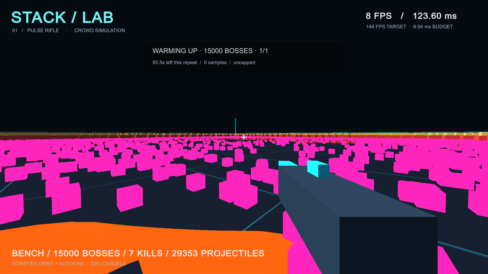

# Boss-scale diagnostic — 2026-09-30

**Result: the current implementation fails the 144 FPS target at the new scale.** This is an automated developer-machine diagnostic, not a user playtest or target-hardware validation. The owner's late-game ambition exceeds 10,000 active bosses; the old 1,000-drone result does not validate that ambition.

## Build and functional checks

- Unity 6000.3.25f1, URP 17.3.0, Windows x64 release player, Mono, Direct3D 11.
- 15 EditMode tests and one PlayMode test passed; release build succeeded. Tests cover the 20,000-enemy capacity/neighbor-work bound, boss activation/pause/reset/lifetime behavior, swept projectile collision, and the previous combat checks.
- Visible capture source: clean commit `a8e0a0ee94894f275275471dd1ae395262d7ec34`. Later changes in this report are documentation/evidence only.
- Intel Core i7-10700K, RTX 3090, 65,358 MB reported system memory. This is faster hardware than the intended i7-8700K / GTX 1080 Ti baseline.
- 1920 × 1080 window, uncapped, VSync off, 100% render scale, no shadows. Unity's quality slot is named Ultra; the prototype's explicit pipeline settings are authoritative.

## Visible 15,000-boss capture

30-second wall-clock warm-up, 60-second wall-clock capture, one repeat, seed 137, staggered `boss-mixed-v1` abilities. This is a diagnostic rather than the required three-repeat acceptance suite. A screenshot was captured during warm-up. The game remained visible; the screenshot confirms the crowd, projectiles, warning rings, and HUD render. No runtime exception/error was logged.

| Measurement | Result |
| --- | ---: |
| Sampled frames | 404 |
| Median frame time | 145.39 ms |
| p95 / p99 | 169.49 / 172.55 ms |
| Maximum | 174.51 ms |
| Average throughput | 6.74 FPS |
| Frames over 6.944 ms | 404 / 404 |
| Mean measured simulation CPU time per rendered frame | 141.04 ms |
| Mean available GPU frame timing | 7.28 ms |
| Simulation catch-up limit frames | 292 |
| Simulated time during capture | 53.87 seconds |
| Peak observed active projectiles | 30,814 |
| Peak observed area warnings | 1,031 |
| Completed ability activations during capture | 126,178 |
| Projectile spawns during capture | 508,944 |
| Boss state / projectile updates during capture | 48,480,000 / 91,918,509 |
| Dropped projectiles, including warm-up | 0 |

The simulation could not maintain wall-clock pace: it reached the eight-ticks-per-frame catch-up bound and discarded time. **This invalidates acceptance regardless of FPS.** CPU simulation time includes catch-up ticks, not one tick. GPU timing and frame interval columns are not synchronized traces, and CPU/GPU work can overlap.

The strongest measured bottleneck is the current main-thread simulation. The GPU mean also exceeds the entire 6.944 ms budget on this machine, so CPU improvements alone would not establish a pass. A profiler capture must separate avoidance, ability/projectile simulation, render submission, and GPU work before choosing optimizations.

Evidence: [JSON report](evidence/2026-09-30-visible-15000-bosses.json), [invocation settings](evidence/2026-09-30-visible-15000-invocation.json). Raw CSV and player log remain in the ignored local `prototypes/001-stacked-weapons/BenchmarkResults/visible-15000-bosses/` directory.

Readability is poor at this density: overlapping bodies, opaque projectiles, and many overlapping area warnings obscure the arena. The warning rings use the same locations when several bosses target the player at once. Improving throughput would not by itself make this playable.

## Earlier hidden smoke checks

The 10,000- and 20,000-boss smoke checks used one-second warm-up and five-second capture with a hidden window. They verify launch, workload counters, export, and failure reporting only. Do not use their FPS as rendering performance evidence. Their build stamp names parent `934d976` with `dirty: true`; the runtime changes were subsequently committed as `a8e0a0e`.

- 10,000: 20,462 peak observed projectiles, no projectile drops, no catch-up limit events in the short capture. [Report](evidence/2026-09-30-hidden-10000-bosses.json).
- 20,000: 40,399 peak observed projectiles, no projectile drops, 24 catch-up limit frames, only 3.20 seconds of simulation during the five-second capture. [Report](evidence/2026-09-30-hidden-20000-bosses.json).

A subsequent hidden smoke check exercised `-SynchronizedAbilities` on the clean `a8e0a0e` build: 20,000 bosses produced a peak of **80,000 active projectiles**, with no pool drops and 23 catch-up limit frames. This verifies the aligned spike path and demonstrates another simulation failure, not rendering performance. [Aligned-spike report](evidence/2026-09-30-hidden-20000-synchronized.json).

## Next decision

Keep Unity/C# and use this as a reproducible failed baseline. Profile the simulation and rendering, then evaluate batched Jobs/Burst and more efficient instance submission with identical workloads and recorded visual tradeoffs. A custom engine would still need to solve these workload costs. Final boss visuals, animation, complex abilities, and maximum stacked weapons remain absent; do not extrapolate a future pass from this synthetic harness.
