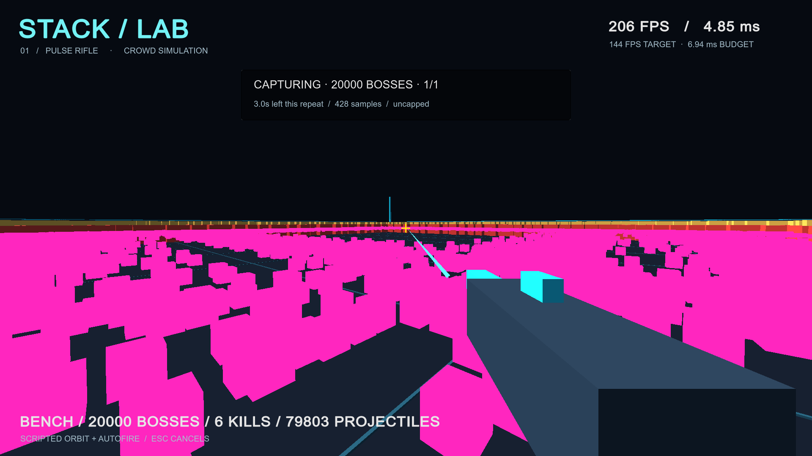

# Effect rendering, job scheduling, and native-state experiments

We tested four proposed changes against the existing Jobs/Burst + culled-rendering control: isolating effect rendering costs, merging identical warning visuals, overlapping instance-preparation jobs, and keeping crowd/projectile motion state in native arrays. All modes remain selectable. The ordinary gameplay defaults remain unchanged while we assess the results.

## Configuration and correctness

- Current desktop: Intel Core i7-10700K, NVIDIA GeForce RTX 3090, approximately 64 GB RAM. Visible 1920 x 1080 window, 100% render scale, uncapped, VSync off, no shadows.
- Unity 6000.3.25f1; Burst 1.8.30, Collections 2.6.8, Mathematics 1.3.3, URP 17.3.0. Windows x64 release, Mono, DX11, verified native Burst compilation, batch size 128.
- Aligned player source: clean `b44fce7` (full revision in each JSON). Twenty thousand synthetic bosses, synchronized abilities, scripted orbit/autofire, seed 137, unchanged 60 Hz gameplay. Draw submission remains in batches of up to 500.
- 25 EditMode and two PlayMode tests passed. Coverage includes native/staged parity for crowd motion, neighbor counts, weapon results, ability activity, projectile order/collisions, interpolation and reset; 20,000-boss synchronized workload parity; exact warning identity; independent preparation buffers; rendered combinations and diagnostic modes.
- Windows Balanced power plan; NVIDIA driver reported as `32.0.15.9186`. No power/driver settings were changed. See [driver metadata](evidence/frame-spikes/graphics-driver.json).
- No compilation or competing benchmark ran during the release captures. These are measurements on a working desktop, not a controlled hardware lab.

The diagnostics omit preparation and drawing for the selected effect category, but preserve all attacks and collision processing. They are explicitly labeled `diagnosticOnly` in reports and on screen and are excluded from passing the summarizer's p99 check. They isolate the combined CPU/GPU rendering cost of a category, not GPU cost alone.

Warning deduplication requires an exact match of target coordinates and remaining cast time; current rings also share geometry, size, material, and appearance. It does not merge nearby positions or different deadlines. Every underlying attack still executes independently. New visual properties or threat cues will require extending the identity key.

## Correcting a capture-phase problem

The initial exploratory captures (`prealignment-` evidence) revealed that startup catch-up losses could shift simulation phase despite equal wall-clock warm-up durations. One control capture included 320,000 projectile spawns versus 399,984 in other 30-second captures. Those runs are preserved for audit and excluded from the controlled tables below.

The corrected harness waits for both simulation and wall-clock warm-up, resets the frame clock between repeats, and records start/end simulation time. All aligned short captures began around 10 simulated seconds and recorded **400,000 projectile spawns**. Timing and activity counters are checked separately from frame-rate results. Source `0295424` is the superseded exploratory implementation; the corrected player is `b44fce7`.

## Aligned screening: one short capture per mode

Each mode used 10 seconds of warm-up followed by 30 seconds of recording. These are exploratory comparisons, not the standard acceptance duration. All rows retain 20,000 active bosses and all gameplay effects; rows marked diagnostic omit only the indicated visuals.

| Mode | Average FPS | p99 ms | Maximum ms |
| --- | ---: | ---: | ---: |
| Control | 229.05 | 11.013 | 21.359 |
| Hide warnings — diagnostic | 226.62 | 11.800 | 15.602 |
| Hide projectiles — diagnostic | 288.93 | 6.003 | 10.586 |
| Hide both — diagnostic | 284.47 | 5.759 | 10.115 |
| Deduplicate identical warnings | 231.58 | 11.610 | 14.527 |
| Overlap preparation jobs | 222.98 | 12.158 | 16.317 |
| Native state ownership | 224.57 | 11.353 | 16.257 |
| All three optimizations combined | 224.55 | 11.297 | 14.824 |

Removing projectile visuals substantially reduced tail frame times while keeping projectile simulation active. Removing warnings alone did not. This identifies projectile rendering as the stronger next investigation; it does not prove a single GPU bottleneck. Small differences among the other one-off captures are not reliable evidence of a speedup or regression.

Native ownership reduced mean projectile simulation cost from about 0.41 to 0.18 ms per tick in the aligned screen. That CPU saving did not translate into improved overall p99 in this run. Preparation scheduling, submission, and GPU work still determine the rendered frame time.

## Full repeated comparison

Each mode received three fresh-process runs with 30 seconds of warm-up and 60 seconds of capture. Order rotated: control/native/combined, native/combined/control, then combined/control/native. All captures began around 30.015 simulated seconds, recorded 720,000 projectile spawns, peaked at 80,000 live projectiles, and maintained approximately 60 seconds of simulation during the measured 60 seconds. Every aligned screening and full capture had zero dropped projectiles and zero catch-up-limit frames.

| Mode | Average FPS range | p99 ms range | Maximum ms range | Projectile ms/tick range |
| --- | ---: | ---: | ---: | ---: |
| Control | 185.65–214.79 | 12.779–14.144 | 17.149–22.431 | 0.455–0.518 |
| Native state | 204.46–209.82 | 11.681–12.416 | 16.328–27.318 | 0.180–0.184 |
| Combined | 198.85–211.97 | 12.215–13.371 | 16.887–21.823 | 0.182–0.196 |

Native ownership consistently reduced projectile simulation cost and had lower p99 in these three full captures. Average FPS ranges overlap, and native mode still had an unexplained 27.318 ms outlier. Do not describe it as a guaranteed throughput improvement or a hard frame-rate minimum.

The combined mode did not consistently outperform native ownership alone. Its mean preparation cost was 0.878–0.952 ms/frame versus the control's 0.996–1.210, but mean submission cost was 0.876–0.963 ms/frame versus 0.670–0.912. Stage placement and overlapping work matter; lower preparation time alone does not establish an end-to-end improvement. Independent scheduling and deduplication modes received only the short screening capture, so their individual effects are not claimed as repeat-validated full-run results.

**No fully visible configuration met the 6.944 ms p99 target.** Keep all experiment modes opt-in. Native ownership is the most useful CPU result to carry forward, while dense projectile rendering needs the next focused investigation. Baseline variability is visible in the ranges; no significance claim or precise overall percentage speedup is warranted from these desktop runs.

### Phase analysis

In the aligned short control capture, intervals associated with more than 5,000 active warnings (and no more than 40,000 projectiles) averaged 5.31 ms; warning deduplication reduced that phase average to 3.49 ms. Its global p99 did not improve because the projectile-heavy phase remained expensive. That is a useful local effect, not evidence that deduplication alone solves the spikes.

Intervals associated with more than 40,000 projectiles averaged 7.09 ms in the short control and 3.65 ms with projectile visuals hidden. In full native-state runs that phase still averaged 7.78–7.93 ms. These categories associate each frame interval with the preceding CSV row's workload counts. They are approximate phase comparisons, not an exactly aligned GPU trace or proof of a sole GPU cause. See [phase calculations](evidence/frame-spikes/phase-analysis.json).

### Visual check

This image comes from a separate visible smoke run and verifies the combined renderer's scene/projectile output. Its HUD FPS and short capture are not acceptance statistics. The dense magenta projectiles are the current placeholder visuals; scene readability remains poor and is a separate gameplay problem.

## Implementation tradeoffs and remaining work

Native ownership removes redundant managed/native staging round trips for crowd/projectile motion and lets renderer jobs read native positions directly. Cooldowns, spawning, weapon logic, and warning gathering remain managed. Interpolation history and GPU uploads still require memory work. Reference/staging allocations remain available for A/B comparisons; this is not a memory-minimized implementation.

Overlapped preparation requires two additional persistent instance-buffer sets (approximately 38 MiB of array payload with the current maximum capacities, excluding allocator overhead). Jobs finish before simulation resumes or buffers are reused/disposed. Scheduling work concurrently is not automatically faster: compare measured frame times, completion waits, and submission costs.

The benchmark still uses placeholder meshes and synthetic boss behaviors. It does not include final animation, complex navigation, stacked weapons, or finished particle effects. Its current projectile cubes and warning rings use opaque materials; transparent-particle overdraw is a future concern, not an established explanation for these captures.

Next, capture the CPU render thread and GPU work during dense projectile volleys, then test cheaper projectile geometry/shading and more efficient instance submission while retaining every gameplay projectile and a readable threat representation. Treat any visual change as an explicit tradeoff. Do not remove attacks, reduce simulation cadence, or count hidden-effect diagnostics as meeting 144 FPS.

See [the experiment protocol and commands](../profiling.md#effect-scheduling-and-native-state-experiments), [raw evidence](evidence/frame-spikes/README.md), and the [current desktop hardware plan](../performance.md).
