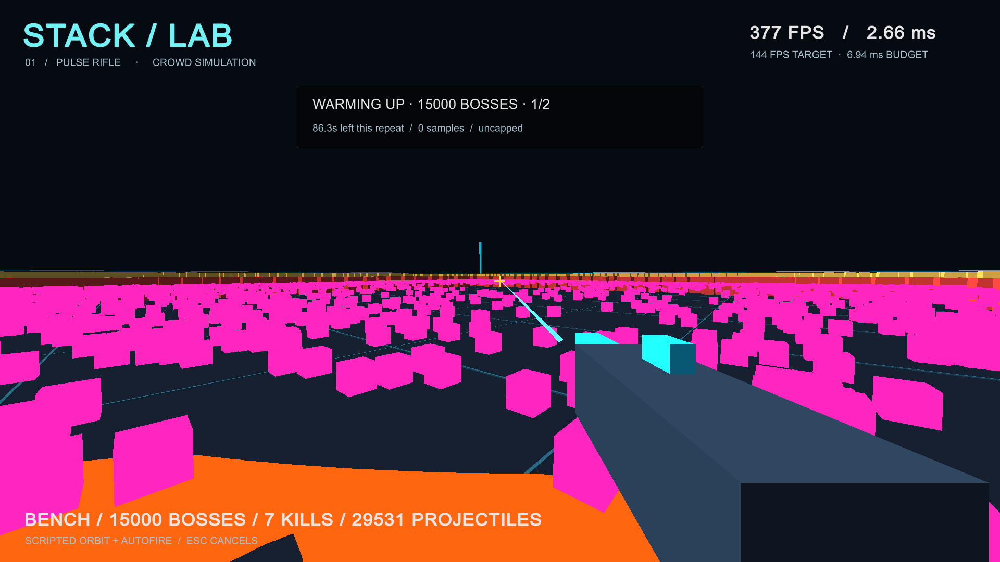

# Jobs/Burst and rendering comparison — 2026-09-30

The 15,000-boss managed baseline was dominated by CPU crowd simulation. This experiment preserves the synthetic boss workload while adding a Jobs/Burst simulation path and a culled renderer, with both improvements independently selectable.

## Reproduction and limits

- Player/runtime source: clean `ac3bf1cf87944ccfe65452a0d28f0bee11fcda4a`. Subsequent profiler-export fixes and documentation do not change player code.
- Unity 6000.3.25f1, Burst 1.8.30, Collections 2.6.8, Mathematics 1.3.3, URP 17.3.0. Windows x64 release, Mono, DX11; actual Burst execution verified by a job probe.
- Developer hardware: i7-10700K, RTX 3090, approximately 64 GB RAM. **These results do not validate the i7-8700K / GTX 1080 Ti target.**
- Visible 1920 × 1080 window, 100% render scale, VSync off, uncapped, seed 137. No builds or competing benchmarks ran during these captures.
- Same 60 Hz gameplay, four-neighbor-per-cell approximation, boss state machine, projectile lifetime/collision, capacity limits, geometry, materials, and scripted route. Culling affects submission only; all enemies/abilities remain active.
- Full comparisons use 30-second warm-up and 60-second capture. Controls receive one capture each; the combined optimized configuration receives three. This is an engineering comparison, not the final acceptance suite on target hardware.
- Failed managed runs lose simulation time and consequently sample different simulation phases over the same wall-clock interval. Compare per-tick costs and work counters, not only FPS; this is not a pixel-identical frame replay.
- The capture timer now starts at the actual end of warm-up, so an overlong warm-up frame cannot shorten recording. Actual wall-clock and simulated durations are reported separately. This correction applies to all comparison paths.

Reproduce with [the profiling guide](../profiling.md), `tools/compare-backends.ps1`, and `tools/summarize-benchmarks.ps1`. Raw frame CSV and binary profiles remain in ignored local `BenchmarkResults` folders. The seven release CSV traces are also preserved in a [compressed evidence archive](evidence/jobs-burst/release-frame-traces.zip). Committed JSON evidence records settings, hardware, source stamp, workload counters, frame distributions, and stage timings.

## Release results

| Configuration | Average FPS | p99 ms | Max ms | Frames > 6.944 ms | Catch-up limit frames |
| --- | ---: | ---: | ---: | ---: | ---: |
| [Managed + original renderer](evidence/jobs-burst/managed-legacy.json) | 7.33 | 149.99 | 151.42 | 440 / 440 | 138 |
| [Jobs/Burst + original renderer](evidence/jobs-burst/burst-legacy.json) | 132.75 | 11.69 | 14.64 | 5314 / 7966 | 0 |
| [Managed + culled renderer](evidence/jobs-burst/managed-culled.json) | 7.26 | 150.15 | 162.04 | 436 / 436 | 126 |
| [Jobs/Burst + culled, A](evidence/jobs-burst/burst-culled-a.json) | 257.41 | 6.40 | 9.39 | 63 / 15445 | 0 |
| [Jobs/Burst + culled, B](evidence/jobs-burst/burst-culled-1.json) | 251.66 | 6.48 | 11.05 | 78 / 15100 | 0 |
| [Jobs/Burst + culled, C](evidence/jobs-burst/burst-culled-2.json) | 255.06 | 6.52 | 20.67 | 79 / 15305 | 0 |
| [20,000 synchronized bosses](evidence/jobs-burst/burst-sync.json) | 222.22 | 11.68 | 16.19 | 1935 / 13334 | 0 |

All runs dropped **zero projectiles**. The three 15,000-boss optimized runs sustained simulation for approximately 60 seconds during each 60-second capture and met the proposed p99 diagnostic threshold on this developer PC. They still had 63–79 slower frames per run, and one run contained a 20.67 ms outlier whose cause is not established. These results are not a hard 144 FPS minimum.

The synchronized 20,000-boss run reached 80,000 live projectiles, completed 180,000 ability activations and 720,000 projectile spawns during capture, and executed 72 million boss-state updates. It preserved simulation time but **failed the p99 threshold**: about 14.5% of frames exceeded 6.944 ms. High average FPS does not remove these spikes.

## Stage costs

| Configuration | Crowd ms/tick | Projectiles ms/tick | Prepare instances ms/frame | Submit instances ms/frame | Mean instance batches/frame |
| --- | ---: | ---: | ---: | ---: | ---: |
| Managed + original renderer | 14.151 | 2.175 | 4.776 | 0.548 | 236.2 |
| Jobs/Burst + original renderer | 0.526 | 0.434 | 5.187 | 0.711 | 235.6 |
| Managed + culled renderer | 14.606 | 2.231 | 0.762 | 0.411 | 109.3 |
| Jobs/Burst + culled, A | 0.489 | 0.338 | 0.924 | 0.547 | 109.2 |

The first optimized full run improved average rendered throughput by about 35 times over the managed reference. This includes recovery from repeated catch-up overload; it is not a claim that every operation became 35 times faster. Crowd cost per tick dropped from 14.15 ms to 0.49 ms. With Burst simulation fixed, renderer preparation dropped from 5.19 ms to 0.92 ms when enabling the rendering changes.

The simulation timings include native-buffer copies, job scheduling, reduction/compaction, and completion waits. Boss cooldown transitions/spawning and hitscan weapon work remain managed; expensive steering and projectile integration/collision use Burst. The improvement combines native compilation and job scheduling; this experiment does not isolate their individual contributions.

The optimized renderer uses Burst interpolation, conservative frustum checks, matrix generation, and stable compaction, then submits native matrices in batches of up to 500. The legacy renderer prepares all matrices in managed code and submits batches of 250. This experiment combines renderer preparation, culling, and batch-size changes; it does not isolate each component's contribution. No enemies, ability updates, or on-screen effects are intentionally removed.

## Unity Profiler evidence

Five-second binary traces were captured from separate Development players, with Deep Profiling disabled. The original trace contained 35 frames and the optimized trace 1,669; the different frame/tick counts matter when interpreting totals. The exporter successfully reopened both binary logs and recovered named samples. Development timings are diagnostic only and are not substituted for release results.

The managed trace recorded about 15.74 ms of `Journey.Crowd` time per tick, compared with about 0.53 ms in the optimized trace. The optimized main thread still spends time in instance preparation and job completion waits. Parent/child samples overlap, and worker CPU sums are not wall-clock latency. Use the raw CPU Timeline to investigate waits, not a sum of inclusive sample rows.

Profiler summaries: [managed reference](evidence/jobs-burst/profile-managed.json), [optimized](evidence/jobs-burst/profile-burst.json), [synchronized stress](evidence/jobs-burst/profile-sync.json). Matching Development run metadata: [managed](evidence/jobs-burst/profile-managed-run.json), [optimized](evidence/jobs-burst/profile-burst-run.json), [stress](evidence/jobs-burst/profile-sync-run.json).

The focused stress trace requested ten seconds; its exported summary contains the 2,000-frame window retained by Unity's history limit, not the full raw recording. It confirms named Burst jobs executing on worker threads and shows remaining instance-preparation/completion-wait costs. The full raw trace remains local.

In the release stress CSV, intervals following frames with more than 5,000 warnings averaged 6.24 ms; those following more than 40,000 projectiles (without that many warnings) averaged 7.35 ms; other frames averaged 3.25 ms. This is correlation with the active effect workload, not proof of a sole GPU cause. Investigate overlapping effects, draw submission, and job waits together. The raw GPU timing column can lag and should not be treated as an exactly aligned trace.

## Correctness and visual checks

21 EditMode tests and one PlayMode test passed. New checks verify native Burst execution, 20,000-enemy movement/check-count parity at batch sizes 64/128/256, twelve seconds of boss activation/projectile count/collision parity, projectile order within tolerance, buffer reuse after reset, and stable conservative culling at a frustum edge. These checks do not establish cross-platform bitwise determinism or exhaust every boss encounter.

The screenshot verifies that the optimized renderer still draws the crowded scene, projectile cubes, warning rings, and HUD. Readability remains poor at this density; this task improves performance, not final boss art or combat design.

The warm-up HUD FPS in this image is not the reported acceptance statistic; use the capture distributions above.

## Remaining work

The main CPU bottleneck has been substantially reduced. Keep the optimized path as the default while retaining the controls. Investigate synchronized attack/rendering spikes and the isolated 20.67 ms outlier, then capture on the actual target hardware. Job batching, native state ownership (avoiding staging copies), and overlapping preparation schedules are additional profiling candidates, not guaranteed gains. No claim of target-hardware acceptance is made.

Final animation, complex navigation, summons/chain effects, pickups, stacked player weapons, and finished VFX are still absent. Any performance conclusion applies to `boss-mixed-v1` only. Keep the 144 FPS goal and report slower frames rather than silently reducing the encounter or changing simulation cadence.
