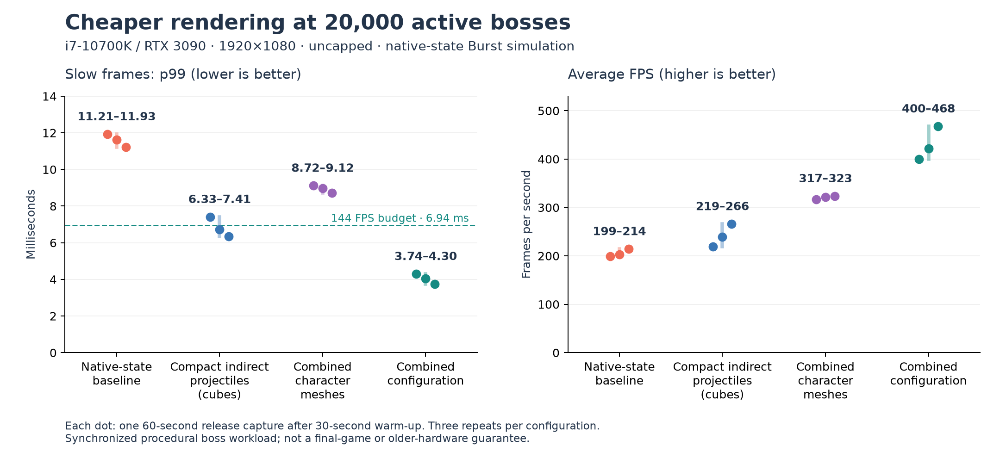

# Cheaper projectile and character renderers

Automated experiments on the current desktop, not a human playtest or final-game hardware claim.

## Question and controls

After native state ownership removed redundant simulation copies, can we reduce the remaining dense-projectile and character rendering costs without removing attacks? Every mode below uses native-state Jobs/Burst simulation, CPU frustum culling, serial preparation, the same seed 137, scripted orbit/autofire, and 20,000 synchronized bosses. All release captures use visible 1920x1080 windows, uncapped FPS, VSync off, and 100% render scale on the i7-10700K / RTX 3090 / approximately 64 GB RAM desktop.

The native baseline retains cube projectiles, separate body/head instances, and per-frame warning collection. No visual category is hidden. CPU collision, ability cadence, simulation frequency, and projectile pool capacity are unchanged. Octahedra have a different silhouette and lower screen coverage; the indirect-cube experiment retains cube geometry to isolate the compact renderer from this visual change.

## Implementation

- `-ProjectileRenderer octa`: six vertices/eight triangles instead of the cube's 24 vertices/twelve triangles, using the existing instanced renderer.
- `-ProjectileRenderer indirect-cube|indirect-octa`: Burst culls/interpolates into stable 16-byte position/scale records instead of 64-byte matrices. Upload visible records to a structured GPU buffer and issue one indirect projectile draw. The CPU supplies the arguments; no gameplay or culling moves to the GPU. The shader retains opaque depth writing, projectile color, and fog.
- `-CombinedCharacters`: combine the exact body/head mesh geometry and normals into one mesh, retain the Simple Lit shader, and use a point-filtered two-color atlas. One instance replaces two; triangle count per character is unchanged. Atlas colors are quantized to RGBA8.
- `-CacheWarnings`: collect warnings once per changed simulation state, retaining exact deduplication identity and deadline distinctions. Reset, ticks, and respawns invalidate the cache. Camera culling continues every rendered frame.

`combined` enables indirect octahedra, combined characters, exact warning deduplication, and warning caching. Overlapped preparation remains off. All new rendering options remain opt-in.

## Short screening captures

One capture per mode, 10s warm-up plus 30s measurement. Source: clean `c5ed740`. These select candidates; they are not repeated full-length acceptance evidence.

| Mode | Average FPS | p99 frame ms | Mean valid GPU ms | Mean submitted batches/frame |
| --- | ---: | ---: | ---: | ---: |
| Native baseline | 214.6 | 11.243 | 4.025 | 113.0 |
| Octahedra only | 228.0 | 10.532 | 3.834 | 112.1 |
| Indirect cubes | 270.8 | 6.387 | 2.929 | 78.8 |
| Indirect octahedra | 278.7 | 6.140 | 2.857 | 78.8 |
| Combined characters | 368.4 | 7.759 | 1.956 | 67.5 |
| Exact warning deduplication | 227.7 | 11.022 | 3.708 | 111.3 |
| Cached deduplicated warnings | 211.4 | 11.833 | 4.000 | 110.2 |
| Combined configuration | 429.1 | 4.005 | 1.243 | 39.0 |

Batch counts are frame-weighted averages across changing phases, not counts from identical fixed ticks. Faster modes sample phases differently. The GPU average for indirect octahedra is recomputed from raw CSV because one disjoint timestamp query returned an impossible duration; the original JSON is preserved unchanged.

## Full release comparison

Three rotated repeats per mode, each with 30s simulation/wall-clock warm-up and 60s capture. All twelve players identify clean source `8fa326a`, which adds timing validation and an offline GPU-profile exporter; renderer/simulation code is unchanged from screening. No other builds or benchmarks ran concurrently; light documentation and result-analysis work continued on this working desktop.

| Configuration | Average FPS range | p99 frame ms range | Worst frame across repeats | Mean GPU ms range | p99 passes |
| --- | ---: | ---: | ---: | ---: | ---: |
| Native-state baseline | 198.8–214.2 | 11.209–11.925 | 18.027 ms | 4.116–4.407 | 0 / 3 |
| Compact indirect projectiles, cubes | 219.0–265.8 | 6.334–7.410 | 11.803 ms | 3.036–3.481 | 2 / 3 |
| Combined character meshes | 316.9–323.5 | 8.723–9.115 | 14.666 ms | 2.222–2.241 | 0 / 3 |
| Combined configuration | **400.4–467.6** | **3.743–4.297** | **7.502 ms** | **1.246–1.309** | **3 / 3** |

Every full capture completed exactly **3,600 simulation ticks and 720,000 projectile spawns**, with peak active projectiles 80,000, zero dropped projectiles, and zero catch-up-limit events. All were release players with Burst compilation, normal visible windows, and no hidden visual categories. No runtime exceptions or shader errors were logged. No full-run GPU samples were rejected as disjoint.

The combined configuration recorded **two frames over 6.944 ms out of 77,380**: maxima of 7.502, 7.344, and 5.939 ms for repeats 1–3. It meets the proposed p99 gate for this synthetic workload on this desktop; it does not establish a hard 144 FPS minimum. The short screen alone would have overstated projectile-only reliability: one full repeat still missed the p99 target.

With the combined configuration, mean CPU render preparation fell from 0.972–1.064 to 0.454–0.563 ms/frame, and submission from 0.716–0.859 to 0.249–0.329 ms/frame. Mean submitted instance batches fell from about 119 to 41. These are frame-weighted full-run means; they are not GPU draw-call counts or measurements at one fixed simulation tick. Desktop variation is visible, especially in projectile-only FPS, so ranges and individual repeats are preserved instead of claiming a precise universal percentage gain.

## CPU and GPU diagnosis

Separate development captures use source `c5ed740`, 32s warm-up, and a two-second binary profile beginning in a dense-projectile phase. The associated CSV lasts five seconds; it is not the same window as the binary profile. Baseline binary export includes 279 CPU frames / 275 frames with GPU samples; combined includes 625 / 621. Both cover approximately the same simulation phase, with more frames produced by the faster renderer.

| Profiler measurement | Native baseline | Combined |
| --- | ---: | ---: |
| GPU frame inclusive mean | 3.827 ms | 1.355 ms |
| GPU frame maximum | 5.489 ms | 3.697 ms |
| CPU render-thread `RenderLoop.Draw` per captured frame | 2.902 ms | 0.965 ms |
| CPU `Journey.RenderPrepare` per captured frame | 0.902 ms | 0.490 ms |
| CPU `Journey.RenderSubmit` per captured frame | 0.778 ms | 0.222 ms |

Both measured GPU frame time and CPU rendering time fall. The compact renderer changes data layout, shader work, and submission together; this does not isolate the indirect API itself as the sole cause. This is stronger evidence than hiding visuals alone. The combined capture changes several renderer choices, so it cannot assign all of that saving to one technique. Inclusive marker times overlap and must not be summed. GPU timings attached to the Main Thread hierarchy are GPU durations, not CPU execution on that thread. `GPUProfiler.EndQueries` introduces substantial waiting; profiling can change graphics scheduling, so diagnostic timings do not establish release FPS.

## Measurement validity

Schema v5 includes renderer options and main/render-thread engine timings. Engine timings are asynchronous and can include waiting; the raw frame interval is the release acceptance metric. A disjoint GPU query in screening exposed an invalid huge positive duration. `8fa326a` excludes non-finite, nonpositive, and >=1000 ms engine samples from timing means and counts rejected CPU/GPU samples. Raw positive values remain in CSV for audit. `tools/analyze-renderers.py` applies the same rule to historical CSVs. Missing timings are not treated as zero GPU work.

The screenshot is from a separate five-second smoke run, not performance evidence. It verifies that projectiles and characters are present. Dense synchronized projectile fields remain visually cluttered; rendering throughput does not establish readability or game feel.

## Decision and limits

Carry forward native simulation ownership, compact projectile rendering, and combined character meshes. The combined package is the strongest measured option and the only configuration that passes every full repeat. Keep the existing renderer as a comparison path. Octahedra provide an optional additional geometry/silhouette change; the larger projectile gain already appears with identical cube geometry, compact data, and the specialized indirect shader/submission path.

Warning caching is implemented and verified but has **no demonstrated independent performance win** in this screen. Its warning-heavy frame mean was about 3.84 ms versus 3.68 ms for uncached deduplication, within an uncontrolled single-repeat comparison. The combined result includes caching and deduplication and cannot isolate their contributions. Keep those switches available without attributing the renderer win to lazy computation.

We did not add asset lazy loading, drop distant attacks, thin the projectile simulation, or reduce collision updates. There is no evidence asset loading causes these steady-state spikes. Additional visual LOD or GPU culling should be driven by representative animated characters and effects, not added solely because another algorithm exists. First repeat the winning configuration with staggered abilities, richer boss content, and stacked weapons. The current results do not cover animation, complex navigation, transparent VFX, a five-minute gameplay run, cold-start hitches, or older hardware.

Validation: **33 edit-mode tests and two play-mode tests pass**. Tests cover native/staged gameplay parity, compact/matrix frustum and interpolation parity, cache invalidation on ticks/reset/configuration changes, rejected timing queries, actual renderer combinations, and restart/disposal. Raw evidence contains eight screening captures, twelve full captures, two development captures, and one separate visual smoke capture.

## Reproduce and evidence

See [the profiling guide](../profiling.md#projectile-and-character-renderer-experiments), [comparison runner](../../tools/compare-renderers.ps1), and [evidence directory](evidence/renderers/).

Unity references: [indirect mesh rendering](https://docs.unity3d.com/6000.3/Documentation/ScriptReference/Graphics.RenderMeshIndirect.html), [GPU profiling](https://docs.unity3d.com/6000.3/Documentation/Manual/ProfilerGPU.html).
